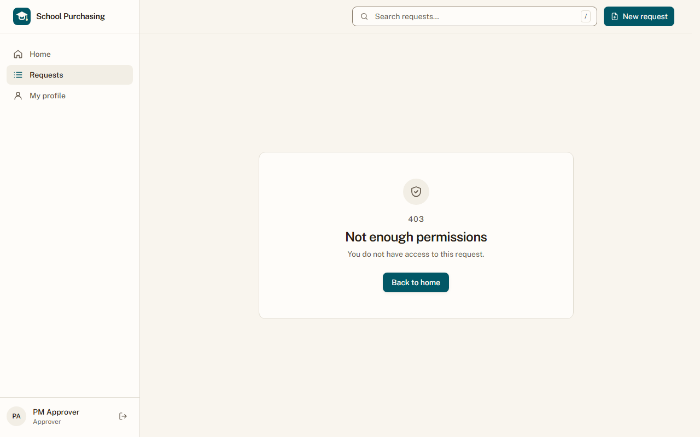
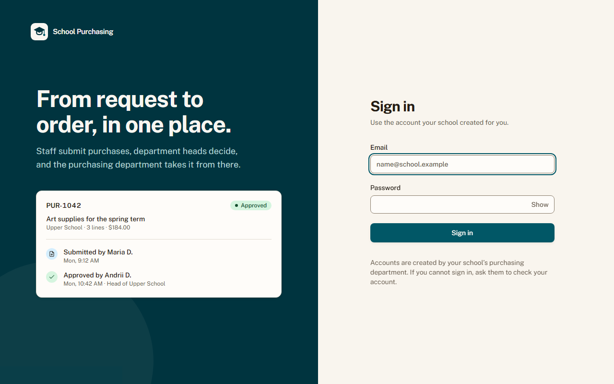
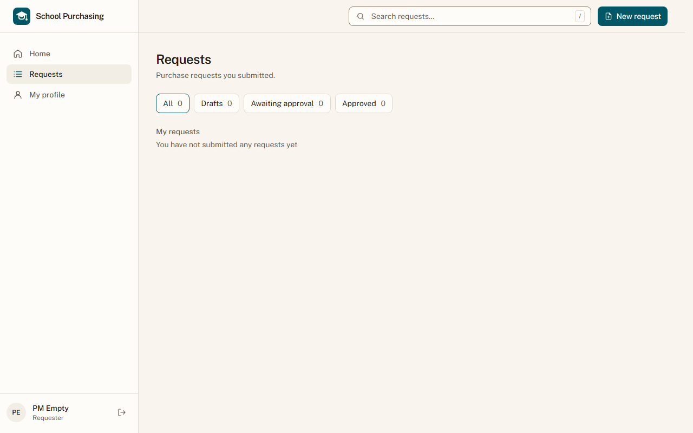

# Звіт UAT — 02.11.2026

- **Застосунок:** https://school-purchasing.vercel.app (/api/health: коміт `f458c84`)
- **Код тестів:** `task/uat` @ `2b53e85` + незакомічені зміни
- **Прогін:** 02.11.2026, 12:35 (Київ), Playwright 29.9 с; AC: 3 — PASS 3, FAIL 0, NEEDS-HUMAN 0
- **Рецензент:** `claude-haiku-5-5`; суперечки → `claude-sonnet-5-5`. Разом за розбір: $0.0615 (ціни API; за підпискою — у межах ліміту плану)
- **Прибирання:** синтетичних uat-*@example.test видалено 0, лишилось 0, їхніх рядків, що лишились: 0
- **Відео й траси:** не в git — `test-results/` локально або артефакт CI; трасу відкриває `npx playwright show-trace <trace.zip>`

| AC | Перевірки | Агент | Підсумок | Чому | Playwright | Розбір |
|---|---|---|---|---|---|---|
| AC-APR-03 | пройшли | Haiku: NEEDS-HUMAN, Sonnet: PASS | **PASS** | R6: перевірки, агент і цитати збігаються | 8.2 с | $0.0304, 22.4 с |
| AC-FRM-09 | пройшли | Haiku: PASS | **PASS** | R6: перевірки, агент і цитати збігаються | 2.6 с | $0.0017, 8.3 с |
| AC-FRM-14 | пройшли | Haiku: NEEDS-HUMAN, Sonnet: PASS | **PASS** | R6: перевірки, агент і цитати збігаються | 3.7 с | $0.0295, 21.7 с |

## AC-APR-03 — PASS

**Тест:** AC-APR-03: схвалювач відкриває за прямим посиланням заявку відділу, який не схвалює, і бачить «Недостатньо прав», даних заявки немає, а статус лишається «Очікує схвалення»

**Критерій** (requirements/48-skhvaliuvach-vyrishuie-svij-viddil.md):

> AC-APR-03: Дано заявка відділу «Офіс» зі статусом «Очікує схвалення», Марія схвалює лише «Початкова школа». Коли Марія відкриває цю заявку за прямим посиланням. Тоді вона бачить повідомлення «Недостатньо прав», даних заявки їй не показано, а статус заявки лишається «Очікує схвалення».

**Кроки:** ✔ Дано: заявка відділу, який схвалювач pm-approver@example.test не схвалює, має статус «Awaiting approval» → ✔ Коли: схвалювач відкриває цю заявку за прямим посиланням → ✔ Тоді: вона бачить повідомлення «Недостатньо прав» (в інтерфейсі англійською: «Not enough permissions», requirements/49), даних заявки їй не показано, а статус заявки лишається «Очікує схвалення»

**Агент (claude-sonnet-5-5, PASS):** На кадрі сторінка 403 із заголовком «Not enough permissions» і текстом «You do not have access to this request.». Номера, відділу, рядків чи статусу заявки не видно, лише кнопка «Back to home».

Haiku сказав NEEDS-HUMAN, тож розбір повторив Sonnet; рішення агента — за Sonnet.

**Цитати агента, звірені зі сторінкою (aria):**
- «Not enough permissions» — є на сторінці
- «You do not have access to this request.» — є на сторінці

**Правило:** R6: перевірки, агент і цитати збігаються

**Відео:** `test-results/artifacts/slice2-схвалювач-і-чужа-за-245ff-ишається-«Очікує-схвалення»-chromium/video.webm` · **траса:** `test-results/artifacts/slice2-схвалювач-і-чужа-за-245ff-ишається-«Очікує-схвалення»-chromium/trace.zip` (не в git)

**Рішення PM:** ☐ приймаю · ☐ відхилення від вимог (issue «Відхилення від вимог: AC-APR-03 — …») · @login: ____

## AC-FRM-09 — PASS

**Тест:** AC-FRM-09: гість за прямим посиланням на форму закупівлі бачить сторінку входу, а форму закупівлі не показано

**Критерій** (requirements/47-pratsivnyk-podaie-zakupivliu-formu.md):

> AC-FRM-09: Дано гість без входу. Коли він відкриває пряме посилання на форму закупівлі. Тоді він бачить сторінку входу, а форму закупівлі не показано.

**Кроки:** ✔ Дано: гість без входу → ✔ Коли: гість відкриває пряме посилання на форму закупівлі → ✔ Тоді: він бачить сторінку входу, а форму закупівлі не показано

**Агент (claude-haiku-5-5, PASS):** На кадрі frame-then-1.png видно сторінку входу School Purchasing: заголовок «Sign in», поля «Email» і «Password», кнопка «Sign in». Заголовка «New request» і форми закупівлі на кадрі немає. Відсутність форми на сторінці перевіряють автоматичні тести, тому її не оцінюю.

**Цитати агента, звірені зі сторінкою (aria):**
- «Sign in» — є на сторінці
- «Email» — є на сторінці
- «Password» — є на сторінці

**Правило:** R6: перевірки, агент і цитати збігаються

**Відео:** `test-results/artifacts/slice2-гість-без-входу-AC--2c359-форму-закупівлі-не-показано-chromium/video.webm` · **траса:** `test-results/artifacts/slice2-гість-без-входу-AC--2c359-форму-закупівлі-не-показано-chromium/trace.zip` (не в git)

**Рішення PM:** ☐ приймаю · ☐ відхилення від вимог (issue «Відхилення від вимог: AC-FRM-09 — …») · @login: ____

## AC-FRM-14 — PASS

**Тест:** AC-FRM-14: працівник без жодної поданої заявки відкриває «Мої заявки» і бачить повідомлення про порожній список, а списку заявок немає

**Критерій** (requirements/47-pratsivnyk-podaie-zakupivliu-formu.md):

> AC-FRM-14: Дано працівник 3 без жодної поданої заявки. Коли він відкриває сторінку «Мої заявки». Тоді він бачить повідомлення «Ви ще не подали жодної заявки», а списку заявок немає.

**Кроки:** ✔ Дано: працівник pm-empty@example.test без жодної поданої заявки увійшов у застосунок → ✔ Коли: відкриває сторінку «Мої заявки» → ✔ Тоді: він бачить повідомлення «Ви ще не подали жодної заявки» (в інтерфейсі англійською: «You have not submitted any requests yet», requirements/49), а списку заявок немає

**Агент (claude-sonnet-5-5, PASS):** На кадрі сторінки Requests видно розділ «My requests» і під ним повідомлення «You have not submitted any requests yet». Лічильники вкладок показують 0. Відсутність таблиці за кадрами не оцінювалась.

Haiku сказав NEEDS-HUMAN, тож розбір повторив Sonnet; рішення агента — за Sonnet.

**Цитати агента, звірені зі сторінкою (aria):**
- «My requests» — є на сторінці
- «You have not submitted any requests yet» — є на сторінці

**Правило:** R6: перевірки, агент і цитати збігаються

**Відео:** `test-results/artifacts/slice2-працівник-без-жодно-db4f5-писок-а-списку-заявок-немає-chromium/video.webm` · **траса:** `test-results/artifacts/slice2-працівник-без-жодно-db4f5-писок-а-списку-заявок-немає-chromium/trace.zip` (не в git)

**Рішення PM:** ☐ приймаю · ☐ відхилення від вимог (issue «Відхилення від вимог: AC-FRM-14 — …») · @login: ____

## Як читати підсумок

- **PASS** — автоматичні перевірки пройшли, агент-рецензент погодився з кадром, а кожну його цитату знайдено на сторінці.
- **FAIL** — впала автоматична перевірка. Агент цього не перекриває: невидимі вади (буфер обміну, база) він на кадрі не побачить.
- **NEEDS-HUMAN** — перевірки зелені, але агент не погодився або його цитати немає на сторінці. Часто це слабкий тест або розбіжність між текстом AC і тестом — питання до PM, а не обов'язково вада продукту.

Правила: R1: перевірка впала — FAIL завжди, агент не перекриває; R2: немає вердикту агента або кадру; R3: перевірки пройшли, агент не погоджується — вирішує людина; R4: цитати агента немає на сторінці (aria) — не підтверджено; R5: помилка сторінки або 5xx під час сценарію; R6: перевірки, агент і цитати збігаються.
