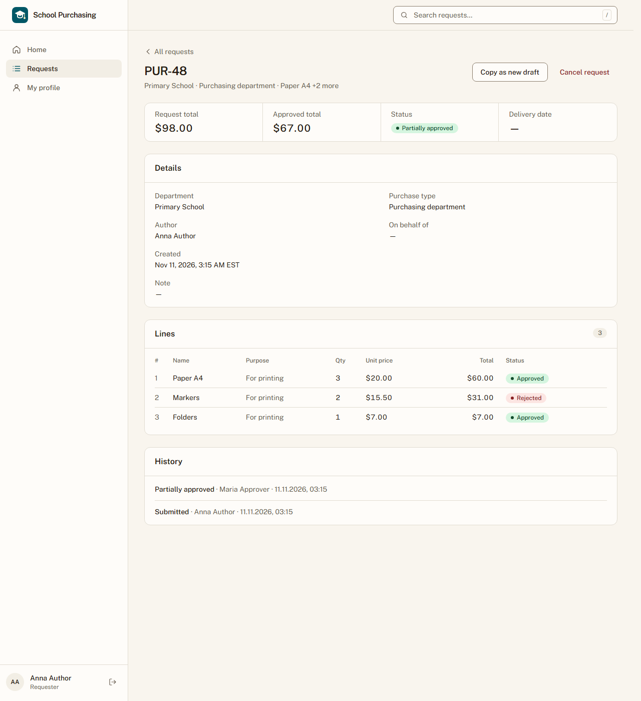

# Звіт UAT — 11.11.2026

- **Застосунок:** https://school-purchasing.vercel.app (/api/health: коміт `004199f`)
- **Код тестів:** `task/proof-pack-ws9-final` @ `a511ae8`
- **Прогін:** 11.11.2026, 10:14 (Київ), Playwright 41.7 с; AC: 1 — PASS 1, FAIL 0, NEEDS-HUMAN 0
- **Рецензент:** `claude-haiku-5-5`; суперечки → `claude-sonnet-5-5`. Разом за розбір: $0.0449 (ціни API; за підпискою — у межах ліміту плану)
- **Прибирання:** синтетичних uat-*@example.test видалено 2, лишилось 0, їхніх рядків, що лишились: 0
- **Відео й траси:** не в git — `test-results/` локально або артефакт CI; трасу відкриває `npx playwright show-trace <trace.zip>`

| AC | Перевірки | Агент | Підсумок | Чому | Playwright | Розбір |
|---|---|---|---|---|---|---|
| AC-DEC-01 | пройшли | Haiku: NEEDS-HUMAN, Sonnet: PASS | **PASS** | R6: перевірки, агент і цитати збігаються | 20.9 с | $0.0449, 26.7 с |

## AC-DEC-01 — PASS

**Тест:** AC-DEC-01: Марія відхиляє рядок 2 і схвалює заявку — статус заявки «Частково схвалено», автор бачить рядок 2 зі статусом «Відхилено», а рядки 1 і 3 — зі статусом «Схвалено»

**Критерій** (requirements/63-skhvaliuvach-chastkovo-skhvaliuie-povertaie.md):

> AC-DEC-01: Дано заявка відділу «Початкова школа» з трьома рядками зі статусом «Очікує схвалення», автор — не Марія, Марія схвалює цей відділ. Коли Марія відхиляє рядок 2 і схвалює заявку. Тоді статус заявки «Частково схвалено», автор бачить рядок 2 зі статусом «Відхилено», а рядки 1 і 3 — зі статусом «Схвалено».

**Кроки:** ✔ Дано: заявка відділу «Primary School» з трьома рядками зі статусом «Awaiting approval», автор — не Марія, Марія схвалює цей відділ → ✔ Коли: Марія відхиляє рядок 2 і схвалює заявку → ✔ Тоді: статус заявки «Частково схвалено», автор бачить рядок 2 зі статусом «Відхилено», а рядки 1 і 3 — зі статусом «Схвалено»

**Агент (claude-sonnet-5-5, PASS):** На кадрі сторінка PUR-48 (Primary School, автор Anna Author) зі статусом «Partially approved». У таблиці рядків: Paper A4 — Approved, Markers — Rejected, Folders — Approved. Історія показує, що Maria Approver частково схвалила заявку.

Haiku сказав NEEDS-HUMAN, тож розбір повторив Sonnet; рішення агента — за Sonnet.

**Цитати агента, звірені зі сторінкою (aria):**
- «PUR-48» — є на сторінці
- «Status» — є на сторінці
- «Partially approved» — є на сторінці
- «1 Paper A4 For printing 3 $20.00 $60.00 Approved» — є на сторінці
- «2 Markers For printing 2 $15.50 $31.00 Rejected» — є на сторінці
- «3 Folders For printing 1 $7.00 $7.00 Approved» — є на сторінці

**Правило:** R6: перевірки, агент і цитати збігаються

**Відео:** `test-results/artifacts/slice3-рішення-схвалювача--fc215--3-—-зі-статусом-«Схвалено»-chromium/video.webm` · **траса:** `test-results/artifacts/slice3-рішення-схвалювача--fc215--3-—-зі-статусом-«Схвалено»-chromium/trace.zip` (не в git)

**Рішення PM:** ☐ приймаю · ☐ відхилення від вимог (issue «Відхилення від вимог: AC-DEC-01 — …») · @login: ____

## Як читати підсумок

- **PASS** — автоматичні перевірки пройшли, агент-рецензент погодився з кадром, а кожну його цитату знайдено на сторінці.
- **FAIL** — впала автоматична перевірка. Агент цього не перекриває: невидимі вади (буфер обміну, база) він на кадрі не побачить.
- **NEEDS-HUMAN** — перевірки зелені, але агент не погодився або його цитати немає на сторінці. Часто це слабкий тест або розбіжність між текстом AC і тестом — питання до PM, а не обов'язково вада продукту.

Правила: R1: перевірка впала — FAIL завжди, агент не перекриває; R2: немає вердикту агента або кадру; R3: перевірки пройшли, агент не погоджується — вирішує людина; R4: цитати агента немає на сторінці (aria) — не підтверджено; R5: помилка сторінки або 5xx під час сценарію; R6: перевірки, агент і цитати збігаються.
