# Звіт UAT — 12.11.2026

- **Застосунок:** https://school-purchasing.vercel.app (/api/health: коміт `eaaf2fd`)
- **Код тестів:** `task/proof-pack-final-ws9` @ `d62f2c3` + незакомічені зміни
- **Прогін:** 12.11.2026, 11:19 (Київ), Playwright 186.1 с; AC: 12 — PASS 12, FAIL 0, NEEDS-HUMAN 0
- **Рецензент:** `claude-haiku-5-5`; суперечки → `claude-sonnet-5-5`. Разом за розбір: $0.2350 (ціни API; за підпискою — у межах ліміту плану)
- **Прибирання:** синтетичних uat-*@example.test видалено 17, лишилось 0, їхніх рядків, що лишились: 0
- **Відео й траси:** не в git — `test-results/` локально або артефакт CI; трасу відкриває `npx playwright show-trace <trace.zip>`

| AC | Перевірки | Агент | Підсумок | Чому | Playwright | Розбір |
|---|---|---|---|---|---|---|
| AC-APR-03 | пройшли | Haiku: NEEDS-HUMAN, Sonnet: PASS | **PASS** | R6: перевірки, агент і цитати збігаються | 15.1 с | $0.0315, 21.5 с |
| AC-DEC-01 | пройшли | Haiku: FAIL, Sonnet: PASS | **PASS** | R6: перевірки, агент і цитати збігаються | 20.9 с | $0.0365, 24.9 с |
| AC-DEC-04 | пройшли | Haiku: NEEDS-HUMAN, Sonnet: PASS | **PASS** | R6: перевірки, агент і цитати збігаються | 12.0 с | $0.0315, 22.5 с |
| AC-DEC-06 | пройшли | Haiku: FAIL, Sonnet: PASS | **PASS** | R6: перевірки, агент і цитати збігаються | 11.2 с | $0.0319, 28.1 с |
| AC-DEC-07 | пройшли | Haiku: FAIL, Sonnet: PASS | **PASS** | R6: перевірки, агент і цитати збігаються | 12.7 с | $0.0313, 23.5 с |
| AC-FRM-09 | пройшли | Haiku: PASS | **PASS** | R6: перевірки, агент і цитати збігаються | 2.8 с | $0.0021, 7.0 с |
| AC-FRM-14 | пройшли | Haiku: FAIL, Sonnet: PASS | **PASS** | R6: перевірки, агент і цитати збігаються | 4.8 с | $0.0300, 20.2 с |
| AC-HIST-01 | пройшли | Haiku: PASS | **PASS** | R6: перевірки, агент і цитати збігаються | 8.0 с | $0.0022, 9.6 с |
| AC-HIST-02 | пройшли | Haiku: PASS | **PASS** | R6: перевірки, агент і цитати збігаються | 8.3 с | $0.0022, 8.5 с |
| AC-HIST-06 | пройшли | Haiku: PASS | **PASS** | R6: перевірки, агент і цитати збігаються | 7.7 с | $0.0026, 9.9 с |
| AC-HIST-10 | пройшли | Haiku: FAIL, Sonnet: PASS | **PASS** | R6: перевірки, агент і цитати збігаються | 8.9 с | $0.0311, 20.3 с |
| AC-LANG-09 | пройшли | Haiku: PASS | **PASS** | R6: перевірки, агент і цитати збігаються | 13.0 с | $0.0021, 9.4 с |

## AC-APR-03 — PASS

**Тест:** AC-APR-03: схвалювач відкриває за прямим посиланням заявку відділу, який не схвалює, і бачить «Недостатньо прав», даних заявки немає, а статус лишається «Очікує схвалення»

**Критерій** (requirements/48-skhvaliuvach-vyrishuie-svij-viddil.md):

> AC-APR-03: Дано заявка відділу «Офіс» зі статусом «Очікує схвалення», Марія схвалює лише «Початкова школа». Коли Марія відкриває цю заявку за прямим посиланням. Тоді вона бачить повідомлення «Недостатньо прав», даних заявки їй не показано, а статус заявки лишається «Очікує схвалення».

**Кроки:** ✔ Дано: заявка відділу, який схвалювач pm-approver@example.test не схвалює, має статус «Awaiting approval» → ✔ Коли: схвалювач відкриває цю заявку за прямим посиланням → ✔ Тоді: вона бачить повідомлення «Недостатньо прав» (в інтерфейсі англійською: «Not enough permissions», requirements/49), даних заявки їй не показано, а статус заявки лишається «Очікує схвалення»

**Агент (claude-sonnet-5-5, PASS):** На кадрі сторінка 403 із заголовком «Not enough permissions» і текстом «You do not have access to this request.». Номера, відділу, рядків і статусу заявки на сторінці немає, є лише кнопка «Back to home».

Haiku сказав NEEDS-HUMAN, тож розбір повторив Sonnet; рішення агента — за Sonnet.

**Цитати агента, звірені зі сторінкою (aria):**
- «Not enough permissions» — є на сторінці
- «403» — є на сторінці
- «Not enough permissions» — є на сторінці
- «You do not have access to this request.» — є на сторінці

**Правило:** R6: перевірки, агент і цитати збігаються

**Відео:** `test-results/artifacts/slice2-схвалювач-і-чужа-за-245ff-ишається-«Очікує-схвалення»-chromium/video.webm` · **траса:** `test-results/artifacts/slice2-схвалювач-і-чужа-за-245ff-ишається-«Очікує-схвалення»-chromium/trace.zip` (не в git)

**Рішення PM:** ☐ приймаю · ☐ відхилення від вимог (issue «Відхилення від вимог: AC-APR-03 — …») · @login: ____

## AC-DEC-01 — PASS

**Тест:** AC-DEC-01: Марія відхиляє рядок 2 і схвалює заявку — статус заявки «Частково схвалено», автор бачить рядок 2 зі статусом «Відхилено», а рядки 1 і 3 — зі статусом «Схвалено»

**Критерій** (requirements/63-skhvaliuvach-chastkovo-skhvaliuie-povertaie.md):

> AC-DEC-01: Дано заявка відділу «Початкова школа» з трьома рядками зі статусом «Очікує схвалення», автор — не Марія, Марія схвалює цей відділ. Коли Марія відхиляє рядок 2 і схвалює заявку. Тоді статус заявки «Частково схвалено», автор бачить рядок 2 зі статусом «Відхилено», а рядки 1 і 3 — зі статусом «Схвалено».

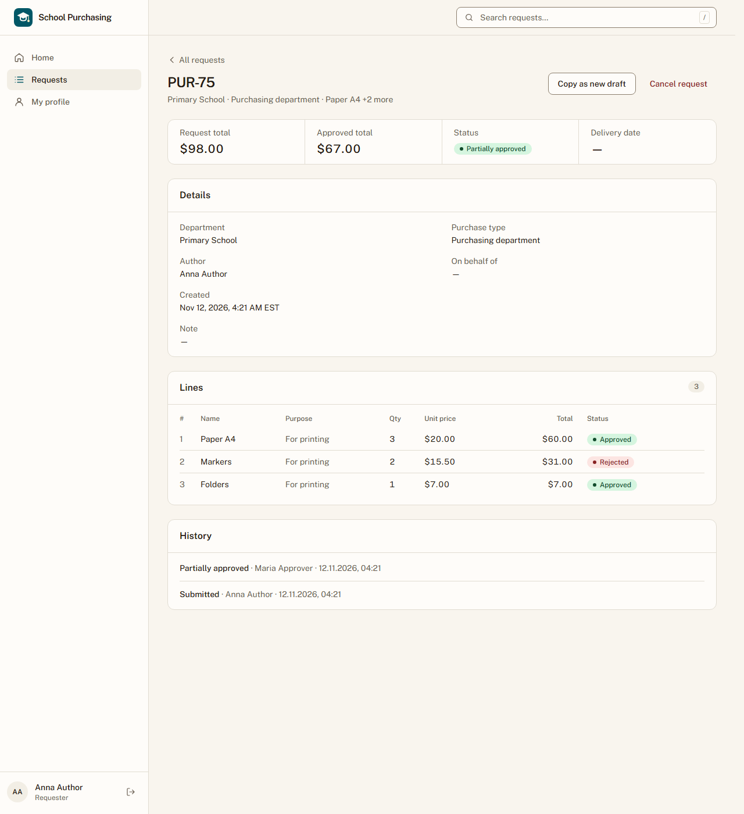

**Кроки:** ✔ Дано: заявка відділу «Primary School» з трьома рядками зі статусом «Awaiting approval», автор — не Марія, Марія схвалює цей відділ → ✔ Коли: Марія відхиляє рядок 2 і схвалює заявку → ✔ Тоді: статус заявки «Частково схвалено», автор бачить рядок 2 зі статусом «Відхилено», а рядки 1 і 3 — зі статусом «Схвалено»

**Агент (claude-sonnet-5-5, PASS):** На кадрі заявка PUR-75 має статус «Partially approved» у картці статусу під заголовком. У таблиці Lines рядки 1 (Paper A4) і 3 (Folders) мають «Approved», рядок 2 (Markers) має «Rejected».

Haiku сказав FAIL, тож розбір повторив Sonnet; рішення агента — за Sonnet.

**Цитати агента, звірені зі сторінкою (aria):**
- «PUR-75» — є на сторінці
- «Status» — є на сторінці
- «Partially approved» — є на сторінці
- «1 Paper A4 For printing 3 $20.00 $60.00 Approved» — є на сторінці
- «2 Markers For printing 2 $15.50 $31.00 Rejected» — є на сторінці
- «3 Folders For printing 1 $7.00 $7.00 Approved» — є на сторінці

**Правило:** R6: перевірки, агент і цитати збігаються

**Відео:** `test-results/artifacts/slice3-рішення-схвалювача--fc215--3-—-зі-статусом-«Схвалено»-chromium/video.webm` · **траса:** `test-results/artifacts/slice3-рішення-схвалювача--fc215--3-—-зі-статусом-«Схвалено»-chromium/trace.zip` (не в git)

**Рішення PM:** ☐ приймаю · ☐ відхилення від вимог (issue «Відхилення від вимог: AC-DEC-01 — …») · @login: ____

## AC-DEC-04 — PASS

**Тест:** AC-DEC-04: Марія повертає заявку на доопрацювання з причиною «Уточніть кількість» — статус заявки «Повернено на доопрацювання»

**Критерій** (requirements/63-skhvaliuvach-chastkovo-skhvaliuie-povertaie.md):

> AC-DEC-04: Дано заявка відділу «Початкова школа» зі статусом «Очікує схвалення», автор — не Марія, Марія схвалює цей відділ. Коли Марія повертає заявку на доопрацювання з причиною «Уточніть кількість». Тоді статус заявки «Повернено на доопрацювання».

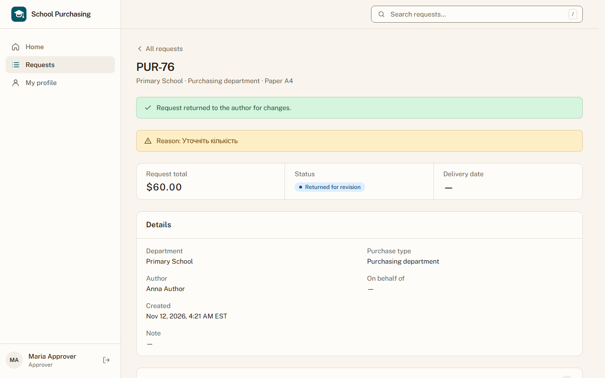

**Кроки:** ✔ Дано: заявка відділу «Primary School» зі статусом «Awaiting approval», автор — не Марія, Марія схвалює цей відділ → ✔ Коли: Марія повертає заявку на доопрацювання з причиною «Уточніть кількість» → ✔ Тоді: статус заявки «Повернено на доопрацювання»

**Агент (claude-sonnet-5-5, PASS):** На сторінці PUR-76 (Primary School) у блоці Status видно бейдж «Returned for revision», а в жовтому банері — «Reason: Уточніть кількість». Також є зелене повідомлення про повернення заявки автору. Користувач — Maria Approver.

Haiku сказав NEEDS-HUMAN, тож розбір повторив Sonnet; рішення агента — за Sonnet.

**Цитати агента, звірені зі сторінкою (aria):**
- «Returned for revision» — є на сторінці
- «Reason: Уточніть кількість» — є на сторінці

**Правило:** R6: перевірки, агент і цитати збігаються

**Відео:** `test-results/artifacts/slice3-рішення-схвалювача--a5ed7-Повернено-на-доопрацювання»-chromium/video.webm` · **траса:** `test-results/artifacts/slice3-рішення-схвалювача--a5ed7-Повернено-на-доопрацювання»-chromium/trace.zip` (не в git)

**Рішення PM:** ☐ приймаю · ☐ відхилення від вимог (issue «Відхилення від вимог: AC-DEC-04 — …») · @login: ____

## AC-DEC-06 — PASS

**Тест:** AC-DEC-06: Марія повертає заявку на доопрацювання без причини — вона бачить повідомлення «Вкажіть причину», а статус заявки лишається «Очікує схвалення»

**Критерій** (requirements/63-skhvaliuvach-chastkovo-skhvaliuie-povertaie.md):

> AC-DEC-06: Дано заявка відділу «Початкова школа» зі статусом «Очікує схвалення», Марія схвалює цей відділ. Коли Марія повертає заявку на доопрацювання без причини. Тоді вона бачить повідомлення «Вкажіть причину», а статус заявки лишається «Очікує схвалення».

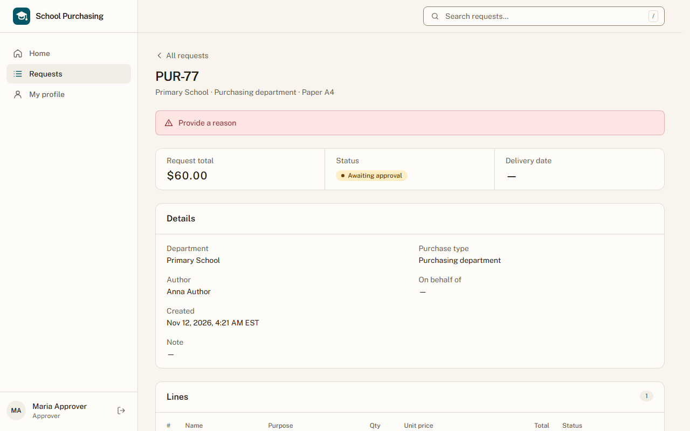

**Кроки:** ✔ Дано: заявка відділу «Primary School» зі статусом «Awaiting approval», Марія схвалює цей відділ → ✔ Коли: Марія повертає заявку на доопрацювання без причини → ✔ Тоді: вона бачить повідомлення «Вкажіть причину», а статус заявки лишається «Очікує схвалення»

**Агент (claude-sonnet-5-5, PASS):** На кадрі сторінки PUR-77 (Primary School) над блоком з підсумком заявки є червоний банер «Provide a reason». У полі Status стоїть «Awaiting approval». Частину про базу даних не оцінював.

Haiku сказав FAIL, тож розбір повторив Sonnet; рішення агента — за Sonnet.

**Цитати агента, звірені зі сторінкою (aria):**
- «Provide a reason» — є на сторінці
- «Awaiting approval» — є на сторінці

**Правило:** R6: перевірки, агент і цитати збігаються

**Відео:** `test-results/artifacts/slice3-рішення-схвалювача--b1ecd-ишається-«Очікує-схвалення»-chromium/video.webm` · **траса:** `test-results/artifacts/slice3-рішення-схвалювача--b1ecd-ишається-«Очікує-схвалення»-chromium/trace.zip` (не в git)

**Рішення PM:** ☐ приймаю · ☐ відхилення від вимог (issue «Відхилення від вимог: AC-DEC-06 — …») · @login: ____

## AC-DEC-07 — PASS

**Тест:** AC-DEC-07: автор виправив рядок 1 повернутої заявки й подає її знову — статус заявки «Очікує схвалення», відділ той самий

**Критерій** (requirements/63-skhvaliuvach-chastkovo-skhvaliuie-povertaie.md):

> AC-DEC-07: Дано заявка зі статусом «Повернено на доопрацювання», автор виправив рядок 1. Коли автор подає заявку знову. Тоді статус заявки «Очікує схвалення», відділ той самий.

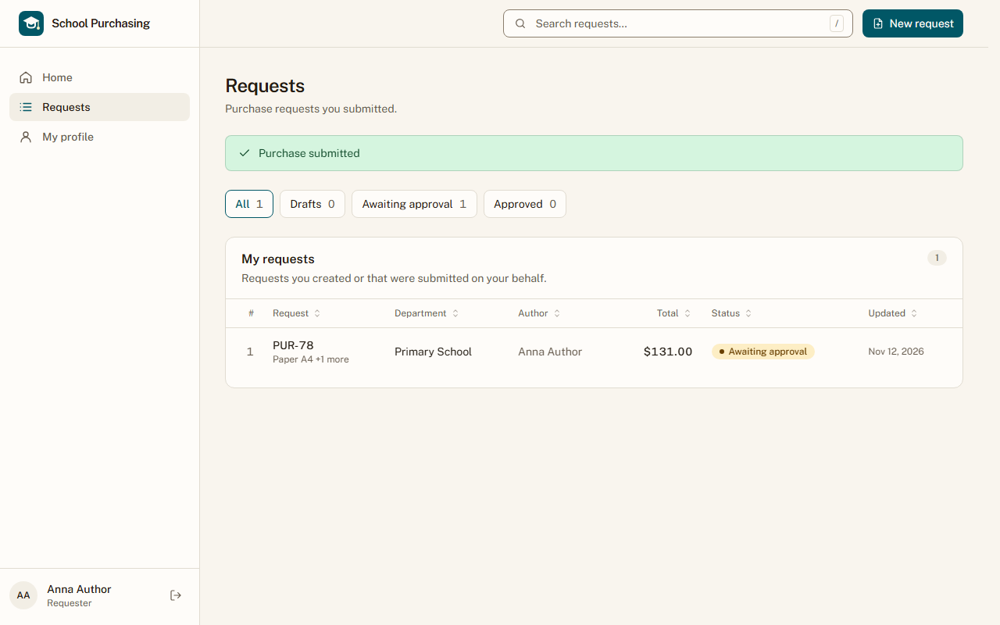

**Кроки:** ✔ Дано: заявка зі статусом «Returned for revision», автор виправив рядок 1 → ✔ Коли: автор подає заявку знову → ✔ Тоді: статус заявки «Очікує схвалення», відділ той самий

**Агент (claude-sonnet-5-5, PASS):** На сторінці Requests є банер «Purchase submitted» і рядок PUR-78 з відділом «Primary School» та статусом «Awaiting approval». Статус стоїть у колонці Status рядка таблиці, а не біля заголовка сторінки, але це статус тієї самої заявки.

Haiku сказав FAIL, тож розбір повторив Sonnet; рішення агента — за Sonnet.

**Цитати агента, звірені зі сторінкою (aria):**
- «Awaiting approval» — є на сторінці
- «Primary School» — є на сторінці

**Правило:** R6: перевірки, агент і цитати збігаються

**Відео:** `test-results/artifacts/slice3-рішення-схвалювача--3746b-схвалення»-відділ-той-самий-chromium/video.webm` · **траса:** `test-results/artifacts/slice3-рішення-схвалювача--3746b-схвалення»-відділ-той-самий-chromium/trace.zip` (не в git)

**Рішення PM:** ☐ приймаю · ☐ відхилення від вимог (issue «Відхилення від вимог: AC-DEC-07 — …») · @login: ____

## AC-FRM-09 — PASS

**Тест:** AC-FRM-09: гість за прямим посиланням на форму закупівлі бачить сторінку входу, а форму закупівлі не показано

**Критерій** (requirements/47-pratsivnyk-podaie-zakupivliu-formu.md):

> AC-FRM-09: Дано гість без входу. Коли він відкриває пряме посилання на форму закупівлі. Тоді він бачить сторінку входу, а форму закупівлі не показано.

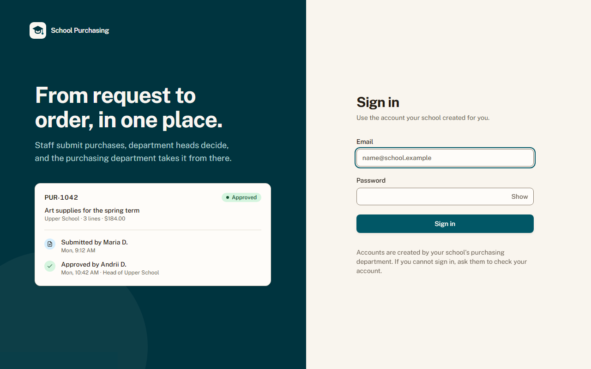

**Кроки:** ✔ Дано: гість без входу → ✔ Коли: гість відкриває пряме посилання на форму закупівлі → ✔ Тоді: він бачить сторінку входу, а форму закупівлі не показано

**Агент (claude-haiku-5-5, PASS):** На кадрі видно сторінку входу: заголовок «Sign in», підзаголовок про обліковий запис від школи, поля «Email» і «Password», кнопка «Sign in». Ознак форми закупівлі (заголовка «New request» чи поля відділу) на кадрі немає, але цю частину за правилами не оцінюю.

**Цитати агента, звірені зі сторінкою (aria):**
- «Sign in» — є на сторінці
- «Email» — є на сторінці
- «Password» — є на сторінці

**Правило:** R6: перевірки, агент і цитати збігаються

**Відео:** `test-results/artifacts/slice2-гість-без-входу-AC--2c359-форму-закупівлі-не-показано-chromium/video.webm` · **траса:** `test-results/artifacts/slice2-гість-без-входу-AC--2c359-форму-закупівлі-не-показано-chromium/trace.zip` (не в git)

**Рішення PM:** ☐ приймаю · ☐ відхилення від вимог (issue «Відхилення від вимог: AC-FRM-09 — …») · @login: ____

## AC-FRM-14 — PASS

**Тест:** AC-FRM-14: працівник без жодної заявки відкриває «Мої заявки» і бачить повідомлення про порожній список, а списку заявок немає

**Критерій** (requirements/47-pratsivnyk-podaie-zakupivliu-formu.md):

> AC-FRM-14: Дано працівник 3 без жодної заявки. Коли він відкриває сторінку «Мої заявки». Тоді він бачить повідомлення «Ви ще не подали жодної заявки», а списку заявок немає.

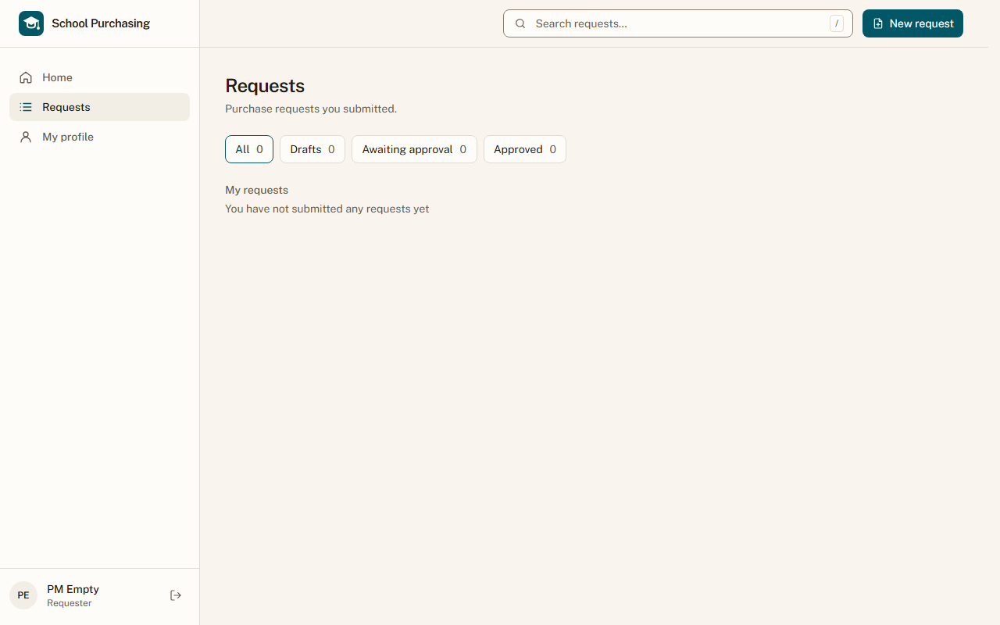

**Кроки:** ✔ Дано: працівник pm-empty@example.test без жодної заявки (чернеток теж) увійшов у застосунок → ✔ Коли: відкриває сторінку «Мої заявки» → ✔ Тоді: він бачить повідомлення «Ви ще не подали жодної заявки» (в інтерфейсі англійською: «You have not submitted any requests yet», requirements/49), а списку заявок немає

**Агент (claude-sonnet-5-5, PASS):** На сторінці Requests видно розділ «My requests» і під ним текст «You have not submitted any requests yet». Лічильники вкладок показують 0. Відсутність таблиці не оцінювалась.

Haiku сказав FAIL, тож розбір повторив Sonnet; рішення агента — за Sonnet.

**Цитати агента, звірені зі сторінкою (aria):**
- «My requests» — є на сторінці
- «You have not submitted any requests yet» — є на сторінці

**Правило:** R6: перевірки, агент і цитати збігаються

**Відео:** `test-results/artifacts/slice2-працівник-без-жодно-38de7-писок-а-списку-заявок-немає-chromium/video.webm` · **траса:** `test-results/artifacts/slice2-працівник-без-жодно-38de7-писок-а-списку-заявок-немає-chromium/trace.zip` (не в git)

**Рішення PM:** ☐ приймаю · ☐ відхилення від вимог (issue «Відхилення від вимог: AC-FRM-14 — …») · @login: ____

## AC-HIST-01 — PASS

**Тест:** AC-HIST-01: працівник 1 подає першу закупівлю, а потім другу — в списку «Мої заявки» вони мають номери «PUR-1» і «PUR-2»

**Критерій** (requirements/64-zaiavka-maie-nomer-sumy-istoriiu.md):

> AC-HIST-01: Дано в системі ще немає жодної закупівлі. Коли працівник 1 подає першу закупівлю, а потім другу. Тоді в списку «Мої заявки» вони мають номери «PUR-1» і «PUR-2».

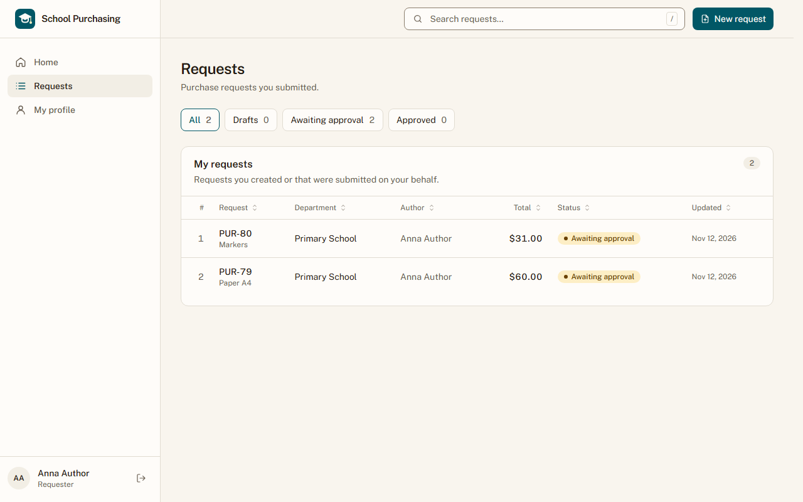

**Кроки:** ✔ Дано: працівник 1 у відділі «Primary School»; нумерація на проді спільна, тож перевіряємо дві закупівлі поспіль → ✔ Коли: працівник 1 подає першу закупівлю, а потім другу → ✔ Тоді: в списку «Мої заявки» вони мають номери «PUR-1» і «PUR-2»

**Агент (claude-haiku-5-5, PASS):** На кадрі сторінка «Requests» із розділом «My requests» (лічильник 2), і в рядках 1 та 2 видно «PUR-80» (Markers, $31.00) та «PUR-79» (Paper A4, $60.00), тобто два номери стоять поспіль. Буквальний текст критерію «PUR-1» і «PUR-2» на кадрі немає, але за переліком видимих частин перевіряються PUR-79 і PUR-80, а відсутність стороннього номера між ними віднесено до «не з кадрів», тому оцінка стосується лише видимої частини.

**Цитати агента, звірені зі сторінкою (aria):**
- «My requests» — є на сторінці
- «PUR-80» — є на сторінці
- «PUR-79» — є на сторінці

**Правило:** R6: перевірки, агент і цитати збігаються

**Відео:** `test-results/artifacts/slice3-номер-суми-й-історі-8c172-ть-номери-«PUR-1»-і-«PUR-2»-chromium/video.webm` · **траса:** `test-results/artifacts/slice3-номер-суми-й-історі-8c172-ть-номери-«PUR-1»-і-«PUR-2»-chromium/trace.zip` (не в git)

**Рішення PM:** ☐ приймаю · ☐ відхилення від вимог (issue «Відхилення від вимог: AC-HIST-01 — …») · @login: ____

## AC-HIST-02 — PASS

**Тест:** AC-HIST-02: автор відкриває закупівлю з двома рядками (кількість 3 за ціною 20.00 і кількість 2 за ціною 15.50) — суми рядків 60.00 і 31.00, а сума заявки 91.00

**Критерій** (requirements/64-zaiavka-maie-nomer-sumy-istoriiu.md):

> AC-HIST-02: Дано закупівля з двома рядками: кількість 3 за ціною 20.00 і кількість 2 за ціною 15.50. Коли автор відкриває заявку. Тоді суми рядків 60.00 і 31.00, а сума заявки 91.00.

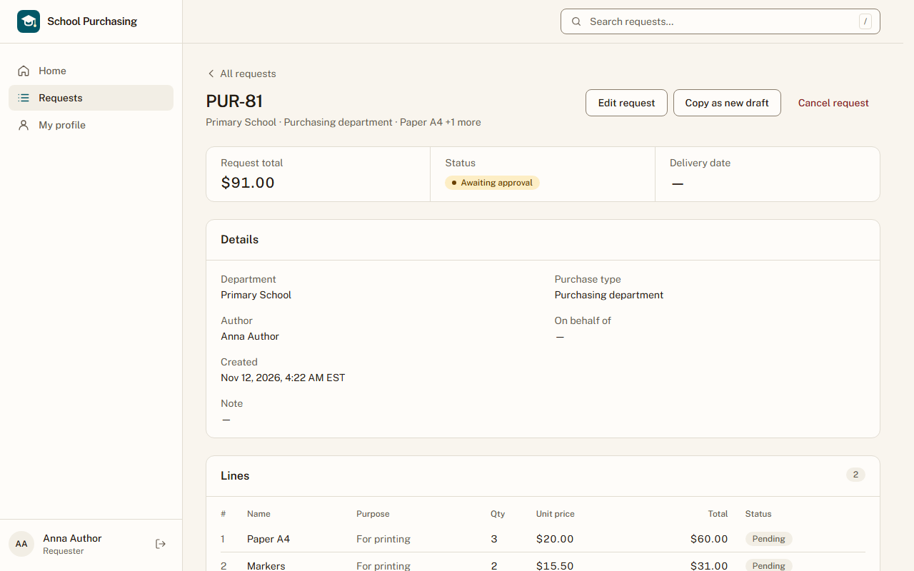

**Кроки:** ✔ Дано: закупівля з двома рядками: кількість 3 за ціною 20.00 і кількість 2 за ціною 15.50 → ✔ Коли: автор відкриває заявку → ✔ Тоді: суми рядків 60.00 і 31.00, а сума заявки 91.00

**Агент (claude-haiku-5-5, PASS):** На кадрі видно таблицю «Lines» з двома рядками: Paper A4 (Qty 3, Unit price $20.00, Total $60.00) і Markers (Qty 2, Unit price $15.50, Total $31.00). Під підписом «Request total» показано $91.00. Нижній рядок таблиці частково обрізаний кадром, але суму $31.00 видно повністю і читабельно.

**Цитати агента, звірені зі сторінкою (aria):**
- «$60.00» — є на сторінці
- «$31.00» — є на сторінці
- «Request total» — є на сторінці
- «$91.00» — є на сторінці

**Правило:** R6: перевірки, агент і цитати збігаються

**Відео:** `test-results/artifacts/slice3-номер-суми-й-історі-3d864-і-31-00-а-сума-заявки-91-00-chromium/video.webm` · **траса:** `test-results/artifacts/slice3-номер-суми-й-історі-3d864-і-31-00-а-сума-заявки-91-00-chromium/trace.zip` (не в git)

**Рішення PM:** ☐ приймаю · ☐ відхилення від вимог (issue «Відхилення від вимог: AC-HIST-02 — …») · @login: ____

## AC-HIST-06 — PASS

**Тест:** AC-HIST-06: працівник 1 подав закупівлю у відділ «Початкова школа» і відкриває її історію — в історії є запис «Подано» з його іменем і датою та часом за часом America/New_York

**Критерій** (requirements/64-zaiavka-maie-nomer-sumy-istoriiu.md):

> AC-HIST-06: Дано працівник 1 подав закупівлю у відділ «Початкова школа». Коли він відкриває історію цієї заявки. Тоді в історії є запис «Подано» з його іменем і датою та часом за часом `America/New_York`.

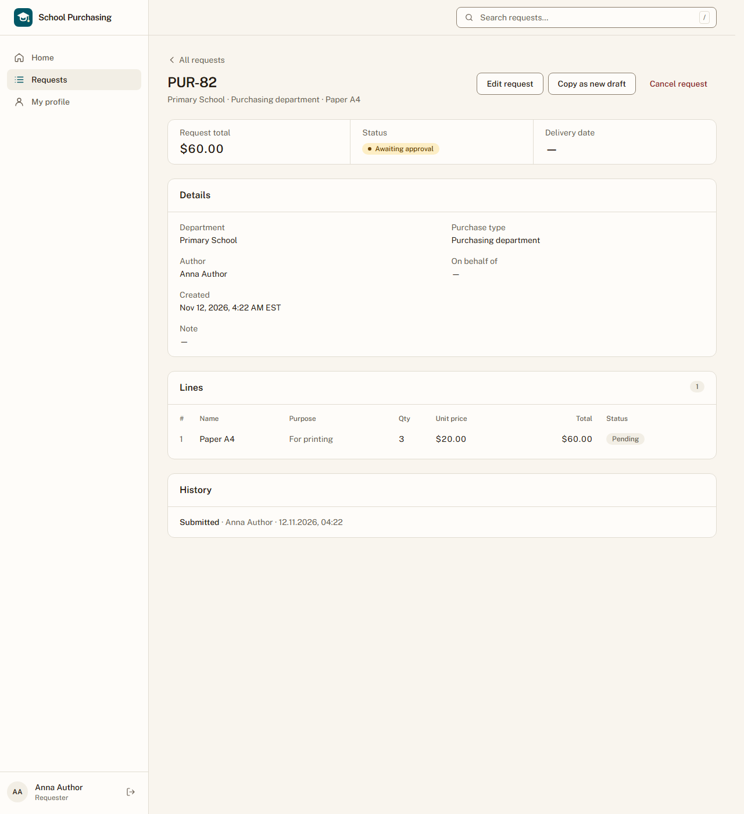

**Кроки:** ✔ Дано: працівник 1 подав закупівлю у відділ «Primary School» → ✔ Коли: він відкриває історію цієї заявки → ✔ Тоді: в історії є запис «Подано» з його іменем і датою та часом за часом America/New_York

**Агент (claude-haiku-5-5, PASS):** У картці History на кадрі видно запис «Submitted · Anna Author · 12.11.2026, 04:22»: формат дати ДД.ММ.РРРР, часу ГГ:ХХ у 24-годинному форматі, без позначки поясу, як вимагає перевірка. Поле Created на тому самому кадрі показує «Nov 12, 2026, 4:22 AM EST», що узгоджується з часом запису. Зауваження: у загальному тексті критерію сказано «Подано», а на екрані напис англійський «Submitted»; за переліком видимих частин, який є еталоном для цієї перевірки, відповідність є, тож позначаю PASS, але PM варто підтвердити мову напису.

**Цитати агента, звірені зі сторінкою (aria):**
- «Submitted · Anna Author · 12.11.2026, 04:22» — є на сторінці

**Правило:** R6: перевірки, агент і цитати збігаються

**Відео:** `test-results/artifacts/slice3-номер-суми-й-історі-ce3de-м-за-часом-America-New-York-chromium/video.webm` · **траса:** `test-results/artifacts/slice3-номер-суми-й-історі-ce3de-м-за-часом-America-New-York-chromium/trace.zip` (не в git)

**Рішення PM:** ☐ приймаю · ☐ відхилення від вимог (issue «Відхилення від вимог: AC-HIST-06 — …») · @login: ____

## AC-HIST-10 — PASS

**Тест:** AC-HIST-10: Петро схвалює лише відділ «Офіс» і відкриває за прямим посиланням історію заявки відділу «Початкова школа» з історією рішень — він бачить повідомлення «Недостатньо прав», історії не показано, а статус заявки не змінився

**Критерій** (requirements/64-zaiavka-maie-nomer-sumy-istoriiu.md):

> AC-HIST-10: Дано Петро схвалює лише відділ «Офіс», заявка відділу «Початкова школа» з історією рішень. Коли Петро відкриває історію цієї заявки за прямим посиланням. Тоді він бачить повідомлення «Недостатньо прав», історії не показано, а статус заявки не змінився.

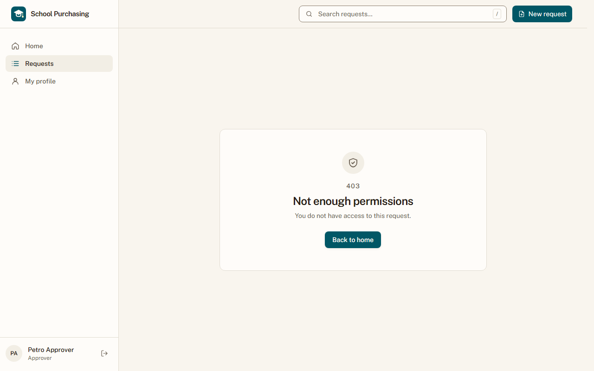

**Кроки:** ✔ Дано: Петро схвалює лише відділ «Office»; заявка відділу «Primary School» з історією рішень (Марія повернула її з причиною) → ✔ Коли: Петро відкриває історію цієї заявки за прямим посиланням → ✔ Тоді: він бачить повідомлення «Недостатньо прав», історії не показано, а статус заявки не змінився

**Агент (claude-sonnet-5-5, PASS):** На кадрі видно сторінку з кодом 403, заголовком «Not enough permissions» і текстом «You do not have access to this request.». Карток «History» та даних заявки немає, є лише кнопка «Back to home». Статус у базі за кадром не оцінювався.

Haiku сказав FAIL, тож розбір повторив Sonnet; рішення агента — за Sonnet.

**Цитати агента, звірені зі сторінкою (aria):**
- «Not enough permissions» — є на сторінці
- «You do not have access to this request.» — є на сторінці

**Правило:** R6: перевірки, агент і цитати збігаються

**Відео:** `test-results/artifacts/slice3-номер-суми-й-історі-f5109-а-статус-заявки-не-змінився-chromium/video.webm` · **траса:** `test-results/artifacts/slice3-номер-суми-й-історі-f5109-а-статус-заявки-не-змінився-chromium/trace.zip` (не в git)

**Рішення PM:** ☐ приймаю · ☐ відхилення від вимог (issue «Відхилення від вимог: AC-HIST-10 — …») · @login: ____

## AC-LANG-09 — PASS

**Тест:** AC-LANG-09: заявки зі статусами «Частково схвалено» і «Повернено на доопрацювання» показано у списку й на сторінці заявки — статус підписано текстом «Partially approved» чи «Returned for revision», а не лише кольором

**Критерій** (requirements/49-interfejs-anhlijskoiu-movoiu.md):

> AC-LANG-09: Дано заявка зі статусом «Частково схвалено» чи «Повернено на доопрацювання». Коли її показано у списку, на сторінці заявки або в історії. Тоді статус підписано текстом «Partially approved» чи «Returned for revision» відповідно, а не лише кольором.

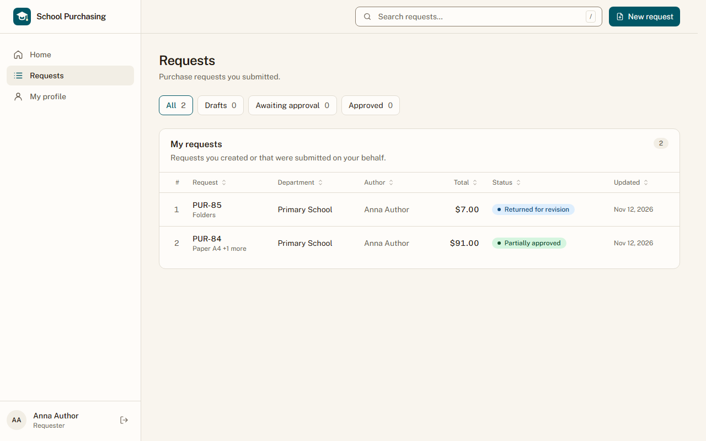

**Кроки:** ✔ Дано: заявки зі статусами «Partially approved» і «Returned for revision» → ✔ Коли: автор відкриває список «Мої заявки» і сторінки цих заявок → ✔ Тоді: статус підписано текстом «Partially approved» чи «Returned for revision» відповідно, а не лише кольором

**Агент (claude-haiku-5-5, PASS):** На кадрі сторінки /requests у таблиці «My requests» статус рядка PUR-84 підписано текстом «Partially approved», а рядка PUR-85 — текстом «Returned for revision», обидва написи читаються посимвольно збіжно з критерієм. Частина про сторінки окремих заявок та історію на цьому кадрі не видна і в моїй оцінці не береться.

**Цитати агента, звірені зі сторінкою (aria):**
- «PUR-84» — є на сторінці
- «Partially approved» — є на сторінці
- «PUR-85» — є на сторінці
- «Returned for revision» — є на сторінці

**Правило:** R6: перевірки, агент і цитати збігаються

**Відео:** `test-results/artifacts/slice3-підписи-статусів-AC-1463e-evision»-а-не-лише-кольором-chromium/video.webm` · **траса:** `test-results/artifacts/slice3-підписи-статусів-AC-1463e-evision»-а-не-лише-кольором-chromium/trace.zip` (не в git)

**Рішення PM:** ☐ приймаю · ☐ відхилення від вимог (issue «Відхилення від вимог: AC-LANG-09 — …») · @login: ____

## Як читати підсумок

- **PASS** — автоматичні перевірки пройшли, агент-рецензент погодився з кадром, а кожну його цитату знайдено на сторінці.
- **FAIL** — впала автоматична перевірка. Агент цього не перекриває: невидимі вади (буфер обміну, база) він на кадрі не побачить.
- **NEEDS-HUMAN** — перевірки зелені, але агент не погодився або його цитати немає на сторінці. Часто це слабкий тест або розбіжність між текстом AC і тестом — питання до PM, а не обов'язково вада продукту.

Правила: R1: перевірка впала — FAIL завжди, агент не перекриває; R2: немає вердикту агента або кадру; R3: перевірки пройшли, агент не погоджується — вирішує людина; R4: цитати агента немає на сторінці (aria) — не підтверджено; R5: помилка сторінки або 5xx під час сценарію; R6: перевірки, агент і цитати збігаються.
