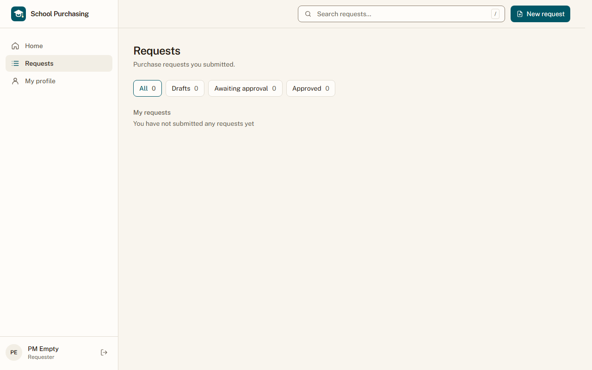
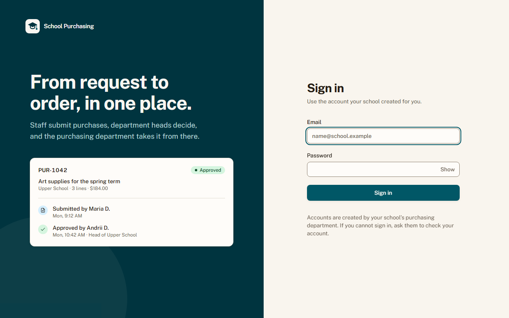
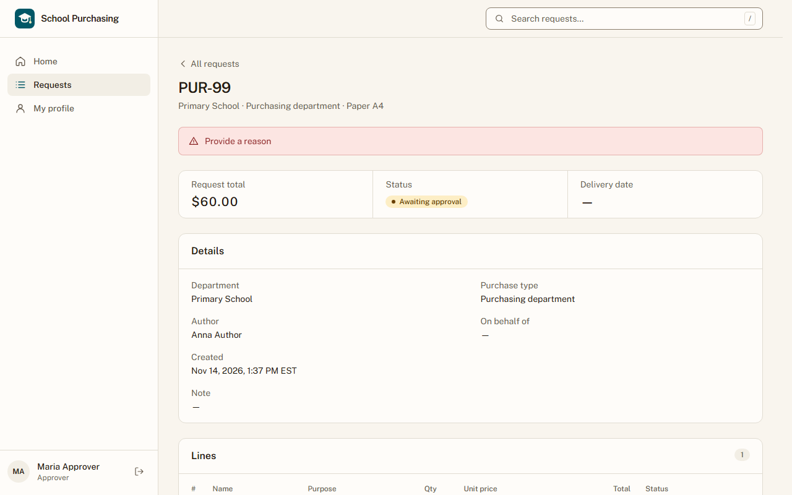

# Звіт UAT — 14.11.2026

- **Застосунок:** https://school-purchasing.vercel.app (/api/health: коміт `82446df`)
- **Код тестів:** `HEAD` @ `82446df` + незакомічені зміни
- **Прогін:** 14.11.2026, 20:37 (Київ), Playwright 52.5 с; AC: 0 — PASS 0, FAIL 0, NEEDS-HUMAN 0; негативних контролів: 3
- **Рецензент:** `claude-haiku-5-5`; суперечки → `claude-sonnet-5-5`. Разом за розбір: $0.0394 (ціни API; за підпискою — у межах ліміту плану)
- **Прибирання:** синтетичних uat-*@example.test видалено 2, лишилось 0, їхніх рядків, що лишились: 0
- **Відео й траси:** не в git — `test-results/` локально або артефакт CI; трасу відкриває `npx playwright show-trace <trace.zip>`

| AC | Перевірки | Агент | Підсумок | Чому | Playwright | Розбір |
|---|---|---|---|---|---|---|
| NC-1 (AC-FRM-14) | впали | Haiku: FAIL | **FAIL** | R1: перевірка впала — FAIL завжди, агент не перекриває | 8.9 с | $0.0020, 9.2 с |
| NC-2 (AC-FRM-09) | пройшли | Haiku: NEEDS-HUMAN, Sonnet: NEEDS-HUMAN | **NEEDS-HUMAN** | R3: перевірки пройшли, агент не погоджується — вирішує людина | 1.7 с | $0.0348, 19.8 с |
| NC-3 (AC-DEC-06) | впали | Haiku: FAIL | **FAIL** | R1: перевірка впала — FAIL завжди, агент не перекриває | 18.9 с | $0.0026, 14.1 с |

## NC-1 — негативний контроль для AC-FRM-14 — FAIL

**Тест:** NC-1 (AC-FRM-14, навмисно хибне очікування в тесті: інший текст порожнього стану)

**Критерій** (requirements/47-pratsivnyk-podaie-zakupivliu-formu.md):

> AC-FRM-14: Дано працівник 3 без жодної заявки. Коли він відкриває сторінку «Мої заявки». Тоді він бачить повідомлення «Ви ще не подали жодної заявки», а списку заявок немає.



**Кроки:** ✔ Дано: працівник pm-empty@example.test без жодної поданої заявки увійшов у застосунок → ✔ Коли: відкриває сторінку «Мої заявки» → ✘ Тоді: він бачить повідомлення «Ви ще не подали жодної заявки» (в інтерфейсі англійською: «You have not submitted any requests yet», requirements/49), а списку заявок немає

**Перевірка впала:**

```
Error: expect(locator).toBeVisible() failed

Locator: getByRole('main').getByText('You have no requests yet', { exact: true })
Expected: visible
Timeout: 5000ms
Error: element(s) not found

Call log:
```

**Агент (claude-haiku-5-5, FAIL):** Сторінка «Requests» (/requests) відкрита для користувача PM Empty, фільтри показують 0 у всіх вкладках, а під заголовком «My requests» немає жодного рядка заявки, тобто список порожній. Однак повідомлення на кадрі англійське, тому відповідність критерію не підтверджена. Рішення FAIL за посимвольним правилом; якщо PM підтвердить англійський текст як очікуваний, перевірку варто повторити з оновленим критерієм.

**Агент бачить вади:**
- Текст на кадрі англійською: «You have not submitted any requests yet». Критерій PM вимагає українською: «Ви ще не подали жодної заявки». Пункт не виконано посимвольно.
- Невідповідність між ac.md і критерієм: у переліку видимих частин «Тоді» в ac.md записано англійський текст, а дослівний критерій PM містить український. Треба уточнити у PM, який текст є очікуваним.

**Правило:** R1: перевірка впала — FAIL завжди, агент не перекриває

**Відео:** `test-results/artifacts/negative-controls-NC-1-пра-a2ae8-ший-текст-порожнього-стану--negative-controls/video.webm` · **траса:** `test-results/artifacts/negative-controls-NC-1-пра-a2ae8-ший-текст-порожнього-стану--negative-controls/trace.zip` (не в git)

_Негативний контроль: навмисно хибне очікування. Очікуваний підсумок — FAIL або NEEDS-HUMAN, не PASS._

## NC-2 — негативний контроль для AC-FRM-09 — NEEDS-HUMAN

**Тест:** NC-2 (AC-FRM-09, текст «Тоді» у вимозі уточнено, тест і застосунок — ні)

**Критерій** (анотація ac-text у тесті (негативний контроль)):

> AC-FRM-09: Дано гість без входу. Коли він відкриває пряме посилання на форму закупівлі. Тоді він бачить сторінку входу із заголовком «Welcome back», а форму закупівлі не показано.



**Кроки:** ✔ Дано: гість без входу → ✔ Коли: гість відкриває пряме посилання на форму закупівлі → ✔ Тоді: він бачить сторінку входу, а форму закупівлі не показано

**Агент (claude-sonnet-5-5, NEEDS-HUMAN):** На кадрі сторінка входу із заголовком «Sign in», полями Email і Password та кнопкою «Sign in»; форми закупівлі немає. Напису «Welcome back» ніде немає, а критерій PM вимагає саме його. Потрібне рішення людини: чий текст еталонний, критерій чи перелік частин.

Haiku сказав NEEDS-HUMAN, тож розбір повторив Sonnet; рішення агента — за Sonnet.

**Агент бачить вади:**
- Розбіжність: дослівний критерій PM вимагає заголовок «Welcome back», а перелік у ac.md — «Sign in». На кадрі є «Sign in», тексту «Welcome back» немає.
- Форми закупівлі на кадрі не видно (це узгоджується з критерієм), але через розбіжність заголовка вердикт однозначно винести не можна.

**Правило:** R3: перевірки пройшли, агент не погоджується — вирішує людина

**Відео:** `test-results/artifacts/negative-controls-NC-2-гіс-3802a-ено-тест-і-застосунок-—-ні--negative-controls/video.webm` · **траса:** `test-results/artifacts/negative-controls-NC-2-гіс-3802a-ено-тест-і-застосунок-—-ні--negative-controls/trace.zip` (не в git)

_Негативний контроль: навмисно хибне очікування. Очікуваний підсумок — FAIL або NEEDS-HUMAN, не PASS._

## NC-3 — негативний контроль для AC-DEC-06 — FAIL

**Тест:** NC-3 (AC-DEC-06, навмисно хибне очікування в тесті: інший текст повідомлення про причину)

**Критерій** (requirements/63-skhvaliuvach-chastkovo-skhvaliuie-povertaie.md):

> AC-DEC-06: Дано заявка відділу «Початкова школа» зі статусом «Очікує схвалення», Марія схвалює цей відділ. Коли Марія повертає заявку на доопрацювання без причини. Тоді вона бачить повідомлення «Вкажіть причину», а статус заявки лишається «Очікує схвалення».



**Кроки:** ✔ Дано: заявка відділу «Primary School» зі статусом «Awaiting approval», Марія схвалює цей відділ → ✔ Коли: Марія повертає заявку на доопрацювання без причини → ✘ Тоді: вона бачить повідомлення «Вкажіть причину», а статус заявки лишається «Очікує схвалення»

**Перевірка впала:**

```
Error: expect(locator).toBeVisible() failed

Locator: getByRole('main').getByText('A reason is required', { exact: true })
Expected: visible
Timeout: 5000ms
Error: element(s) not found

Call log:
```

**Агент (claude-haiku-5-5, FAIL):** На кадрі видно червону плашку «Provide a reason» над карткою заявки PUR-99 і статус «Awaiting approval» у блоці Status. Обидва написи збігаються з переліком видимих частин у ac.md, але не з текстом критерію від PM українською, тому вердикт FAIL за буквальною звіркою. PM має вирішити, чи це очікувана англійська локалізація (тоді критерій або перелік треба узгодити), чи справжня невідповідність.

**Агент бачить вади:**
- Текст повідомлення на екрані англійський «Provide a reason», а критерій дослівно від PM вимагає «Вкажіть причину». За правилом звірки посимвольно це розбіжність.
- Статус на екрані англійський «Awaiting approval», а критерій вимагає «Очікує схвалення». Збіг із переліком у ac.md лише з англійським написом, тож або переклад інтерфейсу не відповідає критерію, або перелік у ac.md застарів.

**Правило:** R1: перевірка впала — FAIL завжди, агент не перекриває

**Відео:** `test-results/artifacts/negative-controls-NC-3-схв-8aad5-т-повідомлення-про-причину--negative-controls/video.webm` · **траса:** `test-results/artifacts/negative-controls-NC-3-схв-8aad5-т-повідомлення-про-причину--negative-controls/trace.zip` (не в git)

_Негативний контроль: навмисно хибне очікування. Очікуваний підсумок — FAIL або NEEDS-HUMAN, не PASS._

## Як читати підсумок

- **PASS** — автоматичні перевірки пройшли, агент-рецензент погодився з кадром, а кожну його цитату знайдено на сторінці.
- **FAIL** — впала автоматична перевірка. Агент цього не перекриває: невидимі вади (буфер обміну, база) він на кадрі не побачить.
- **NEEDS-HUMAN** — перевірки зелені, але агент не погодився або його цитати немає на сторінці. Часто це слабкий тест або розбіжність між текстом AC і тестом — питання до PM, а не обов'язково вада продукту.

Правила: R1: перевірка впала — FAIL завжди, агент не перекриває; R2: немає вердикту агента або кадру; R3: перевірки пройшли, агент не погоджується — вирішує людина; R4: цитати агента немає на сторінці (aria) — не підтверджено; R5: помилка сторінки або 5xx під час сценарію; R6: перевірки, агент і цитати збігаються.
