# Звіт UAT — 14.11.2026

- **Застосунок:** https://school-purchasing.vercel.app (/api/health: коміт `82446df`)
- **Код тестів:** `HEAD` @ `82446df`
- **Прогін:** 14.11.2026, 20:55 (Київ), Playwright 179.0 с; AC: 12 — PASS 12, FAIL 0, NEEDS-HUMAN 0
- **Рецензент:** `claude-haiku-5-5`; суперечки → `claude-sonnet-5-5`. Разом за розбір: $0.2671 (ціни API; за підпискою — у межах ліміту плану)
- **Прибирання:** синтетичних uat-*@example.test видалено 18, лишилось 0, їхніх рядків, що лишились: 0
- **Відео й траси:** не в git — `test-results/` локально або артефакт CI; трасу відкриває `npx playwright show-trace <trace.zip>`

| AC | Перевірки | Агент | Підсумок | Чому | Playwright | Розбір |
|---|---|---|---|---|---|---|
| AC-APR-03 | пройшли | Haiku: FAIL, Sonnet: PASS | **PASS** | R6: перевірки, агент і цитати збігаються | 5.8 с | $0.0316, 17.6 с |
| AC-DEC-01 | пройшли | Haiku: PASS | **PASS** | R6: перевірки, агент і цитати збігаються | 18.9 с | $0.0028, 15.2 с |
| AC-DEC-04 | пройшли | Haiku: NEEDS-HUMAN, Sonnet: PASS | **PASS** | R6: перевірки, агент і цитати збігаються | 12.1 с | $0.0314, 25.6 с |
| AC-DEC-06 | пройшли | Haiku: FAIL, Sonnet: PASS | **PASS** | R6: перевірки, агент і цитати збігаються | 10.8 с | $0.0312, 23.1 с |
| AC-DEC-07 | пройшли | Haiku: FAIL, Sonnet: PASS | **PASS** | R6: перевірки, агент і цитати збігаються | 11.5 с | $0.0342, 23.7 с |
| AC-FRM-09 | пройшли | Haiku: PASS | **PASS** | R6: перевірки, агент і цитати збігаються | 3.3 с | $0.0018, 7.4 с |
| AC-FRM-14 | пройшли | Haiku: FAIL, Sonnet: PASS | **PASS** | R6: перевірки, агент і цитати збігаються | 4.8 с | $0.0305, 18.3 с |
| AC-HIST-01 | пройшли | Haiku: PASS | **PASS** | R6: перевірки, агент і цитати збігаються | 7.6 с | $0.0020, 8.5 с |
| AC-HIST-02 | пройшли | Haiku: PASS | **PASS** | R6: перевірки, агент і цитати збігаються | 7.5 с | $0.0021, 9.5 с |
| AC-HIST-06 | пройшли | Haiku: NEEDS-HUMAN, Sonnet: PASS | **PASS** | R6: перевірки, агент і цитати збігаються | 7.3 с | $0.0371, 23.1 с |
| AC-HIST-10 | пройшли | Haiku: FAIL, Sonnet: PASS | **PASS** | R6: перевірки, агент і цитати збігаються | 10.3 с | $0.0314, 18.0 с |
| AC-LANG-09 | пройшли | Haiku: PASS, Sonnet: PASS | **PASS** | R6: перевірки, агент і цитати збігаються | 14.3 с | $0.0309, 15.8 с |

## AC-APR-03 — PASS

**Тест:** AC-APR-03: схвалювач відкриває за прямим посиланням заявку відділу, який не схвалює, і бачить «Недостатньо прав», даних заявки немає, а статус лишається «Очікує схвалення»

**Критерій** (requirements/48-skhvaliuvach-vyrishuie-svij-viddil.md):

> AC-APR-03: Дано заявка відділу «Офіс» зі статусом «Очікує схвалення», Марія схвалює лише «Початкова школа». Коли Марія відкриває цю заявку за прямим посиланням. Тоді вона бачить повідомлення «Недостатньо прав», даних заявки їй не показано, а статус заявки лишається «Очікує схвалення».

**Кроки:** ✔ Дано: заявка відділу, який схвалювач pm-approver@example.test не схвалює, має статус «Awaiting approval» → ✔ Коли: схвалювач відкриває цю заявку за прямим посиланням → ✔ Тоді: вона бачить повідомлення «Недостатньо прав» (в інтерфейсі англійською: «Not enough permissions», requirements/49), даних заявки їй не показано, а статус заявки лишається «Очікує схвалення»

**Агент (claude-sonnet-5-5, PASS):** На кадрі видно сторінку 403 із заголовком «Not enough permissions» і текстом «You do not have access to this request.». Номера, відділу чи рядків заявки на сторінці немає. Статус заявки з кадру оцінити не можна, і я його не оцінював.

Haiku сказав FAIL, тож розбір повторив Sonnet; рішення агента — за Sonnet.

**Цитати агента, звірені зі сторінкою (aria):**
- «Not enough permissions» — є на сторінці
- «You do not have access to this request.» — є на сторінці

**Правило:** R6: перевірки, агент і цитати збігаються

**Відео:** `test-results/artifacts/slice2-схвалювач-і-чужа-за-245ff-ишається-«Очікує-схвалення»-chromium/video.webm` · **траса:** `test-results/artifacts/slice2-схвалювач-і-чужа-за-245ff-ишається-«Очікує-схвалення»-chromium/trace.zip` (не в git)

**Рішення PM:** ☐ приймаю · ☐ відхилення від вимог (issue «Відхилення від вимог: AC-APR-03 — …») · @login: ____

## AC-DEC-01 — PASS

**Тест:** AC-DEC-01: Марія відхиляє рядок 2 і схвалює заявку — статус заявки «Частково схвалено», автор бачить рядок 2 зі статусом «Відхилено», а рядки 1 і 3 — зі статусом «Схвалено»

**Критерій** (requirements/63-skhvaliuvach-chastkovo-skhvaliuie-povertaie.md):

> AC-DEC-01: Дано заявка відділу «Початкова школа» з трьома рядками зі статусом «Очікує схвалення», автор — не Марія, Марія схвалює цей відділ. Коли Марія відхиляє рядок 2 і схвалює заявку. Тоді статус заявки «Частково схвалено», автор бачить рядок 2 зі статусом «Відхилено», а рядки 1 і 3 — зі статусом «Схвалено».

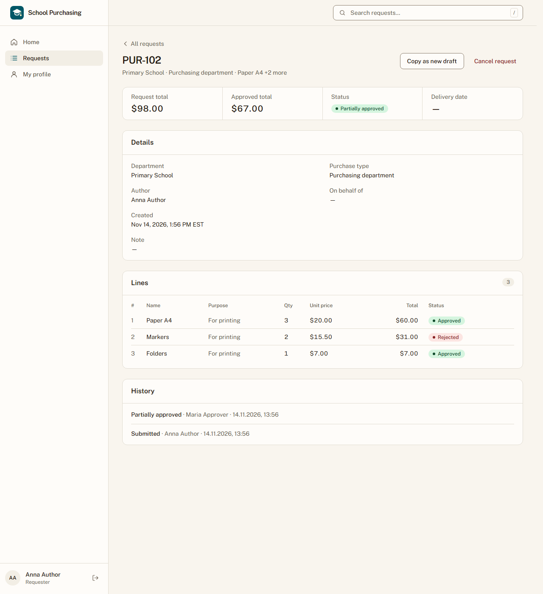

**Кроки:** ✔ Дано: заявка відділу «Primary School» з трьома рядками зі статусом «Awaiting approval», автор — не Марія, Марія схвалює цей відділ → ✔ Коли: Марія відхиляє рядок 2 і схвалює заявку → ✔ Тоді: статус заявки «Частково схвалено», автор бачить рядок 2 зі статусом «Відхилено», а рядки 1 і 3 — зі статусом «Схвалено»

**Агент (claude-haiku-5-5, PASS):** На кадрі PUR-102 у блоці Status видно «Partially approved» (статус заявки). У таблиці Lines рядок 1 Paper A4 — «Approved», рядок 2 Markers — «Rejected», рядок 3 Folders — «Approved». Історія показує «Partially approved · Maria Approver». Зверни увагу: текст критерію в ac.md написаний українською («Частково схвалено», «Відхилено», «Схвалено»), а інтерфейс на кадрі англійський. Я звірив із англомовними написами, які сам ac.md перелічує як очікувані на екрані; якщо PM вимагає саме українські написи в UI, це потрібно підтвердити окремо.

**Цитати агента, звірені зі сторінкою (aria):**
- «Partially approved» — є на сторінці
- «Rejected» — є на сторінці
- «Approved» — є на сторінці
- «Approved» — є на сторінці

**Правило:** R6: перевірки, агент і цитати збігаються

**Відео:** `test-results/artifacts/slice3-рішення-схвалювача--fc215--3-—-зі-статусом-«Схвалено»-chromium/video.webm` · **траса:** `test-results/artifacts/slice3-рішення-схвалювача--fc215--3-—-зі-статусом-«Схвалено»-chromium/trace.zip` (не в git)

**Рішення PM:** ☐ приймаю · ☐ відхилення від вимог (issue «Відхилення від вимог: AC-DEC-01 — …») · @login: ____

## AC-DEC-04 — PASS

**Тест:** AC-DEC-04: Марія повертає заявку на доопрацювання з причиною «Уточніть кількість» — статус заявки «Повернено на доопрацювання»

**Критерій** (requirements/63-skhvaliuvach-chastkovo-skhvaliuie-povertaie.md):

> AC-DEC-04: Дано заявка відділу «Початкова школа» зі статусом «Очікує схвалення», автор — не Марія, Марія схвалює цей відділ. Коли Марія повертає заявку на доопрацювання з причиною «Уточніть кількість». Тоді статус заявки «Повернено на доопрацювання».

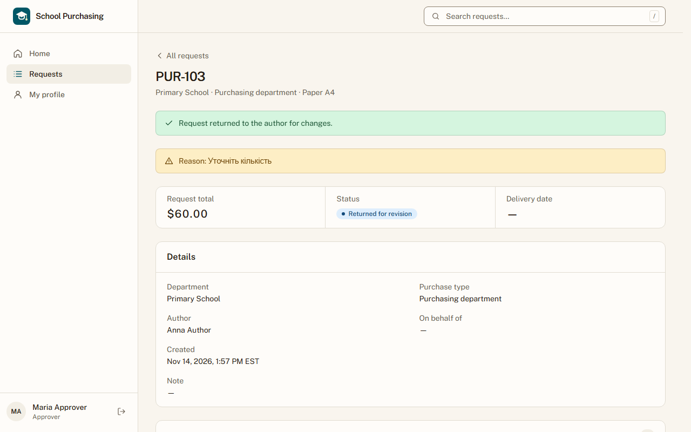

**Кроки:** ✔ Дано: заявка відділу «Primary School» зі статусом «Awaiting approval», автор — не Марія, Марія схвалює цей відділ → ✔ Коли: Марія повертає заявку на доопрацювання з причиною «Уточніть кількість» → ✔ Тоді: статус заявки «Повернено на доопрацювання»

**Агент (claude-sonnet-5-5, PASS):** На сторінці PUR-103 (Primary School) видно бейдж статусу «Returned for revision» у блоці Status і жовте повідомлення «Reason: Уточніть кількість». Також є зелене підтвердження про повернення автору.

Haiku сказав NEEDS-HUMAN, тож розбір повторив Sonnet; рішення агента — за Sonnet.

**Цитати агента, звірені зі сторінкою (aria):**
- «Status» — є на сторінці
- «Returned for revision» — є на сторінці
- «Reason: Уточніть кількість» — є на сторінці

**Правило:** R6: перевірки, агент і цитати збігаються

**Відео:** `test-results/artifacts/slice3-рішення-схвалювача--a5ed7-Повернено-на-доопрацювання»-chromium/video.webm` · **траса:** `test-results/artifacts/slice3-рішення-схвалювача--a5ed7-Повернено-на-доопрацювання»-chromium/trace.zip` (не в git)

**Рішення PM:** ☐ приймаю · ☐ відхилення від вимог (issue «Відхилення від вимог: AC-DEC-04 — …») · @login: ____

## AC-DEC-06 — PASS

**Тест:** AC-DEC-06: Марія повертає заявку на доопрацювання без причини — вона бачить повідомлення «Вкажіть причину», а статус заявки лишається «Очікує схвалення»

**Критерій** (requirements/63-skhvaliuvach-chastkovo-skhvaliuie-povertaie.md):

> AC-DEC-06: Дано заявка відділу «Початкова школа» зі статусом «Очікує схвалення», Марія схвалює цей відділ. Коли Марія повертає заявку на доопрацювання без причини. Тоді вона бачить повідомлення «Вкажіть причину», а статус заявки лишається «Очікує схвалення».

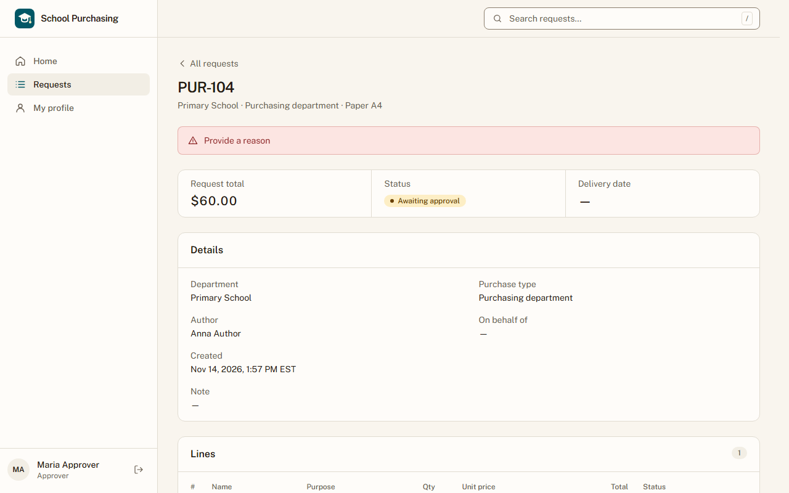

**Кроки:** ✔ Дано: заявка відділу «Primary School» зі статусом «Awaiting approval», Марія схвалює цей відділ → ✔ Коли: Марія повертає заявку на доопрацювання без причини → ✔ Тоді: вона бачить повідомлення «Вкажіть причину», а статус заявки лишається «Очікує схвалення»

**Агент (claude-sonnet-5-5, PASS):** На кадрі сторінки PUR-104 (Primary School) над блоками заявки червоний банер «Provide a reason». У полі Status видно «Awaiting approval». Частину про базу даних не оцінював.

Haiku сказав FAIL, тож розбір повторив Sonnet; рішення агента — за Sonnet.

**Цитати агента, звірені зі сторінкою (aria):**
- «Provide a reason» — є на сторінці
- «Awaiting approval» — є на сторінці

**Правило:** R6: перевірки, агент і цитати збігаються

**Відео:** `test-results/artifacts/slice3-рішення-схвалювача--b1ecd-ишається-«Очікує-схвалення»-chromium/video.webm` · **траса:** `test-results/artifacts/slice3-рішення-схвалювача--b1ecd-ишається-«Очікує-схвалення»-chromium/trace.zip` (не в git)

**Рішення PM:** ☐ приймаю · ☐ відхилення від вимог (issue «Відхилення від вимог: AC-DEC-06 — …») · @login: ____

## AC-DEC-07 — PASS

**Тест:** AC-DEC-07: автор виправив рядок 1 повернутої заявки й подає її знову — статус заявки «Очікує схвалення», відділ той самий

**Критерій** (requirements/63-skhvaliuvach-chastkovo-skhvaliuie-povertaie.md):

> AC-DEC-07: Дано заявка зі статусом «Повернено на доопрацювання», автор виправив рядок 1. Коли автор подає заявку знову. Тоді статус заявки «Очікує схвалення», відділ той самий.

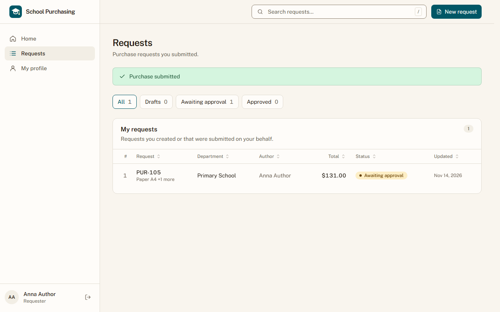

**Кроки:** ✔ Дано: заявка зі статусом «Returned for revision», автор виправив рядок 1 → ✔ Коли: автор подає заявку знову → ✔ Тоді: статус заявки «Очікує схвалення», відділ той самий

**Агент (claude-sonnet-5-5, PASS):** На сторінці Requests є банер «Purchase submitted» і єдиний рядок PUR-105 з відділом «Primary School» та статусом «Awaiting approval». Бейдж статусу стоїть у рядку таблиці, а не поруч із заголовком сторінки, бо це список заявок. Текст збігається з очікуваним.

Haiku сказав FAIL, тож розбір повторив Sonnet; рішення агента — за Sonnet.

**Цитати агента, звірені зі сторінкою (aria):**
- «PUR-105» — є на сторінці
- «Awaiting approval» — є на сторінці
- «PUR-105» — є на сторінці
- «Primary School» — є на сторінці

**Правило:** R6: перевірки, агент і цитати збігаються

**Відео:** `test-results/artifacts/slice3-рішення-схвалювача--3746b-схвалення»-відділ-той-самий-chromium/video.webm` · **траса:** `test-results/artifacts/slice3-рішення-схвалювача--3746b-схвалення»-відділ-той-самий-chromium/trace.zip` (не в git)

**Рішення PM:** ☐ приймаю · ☐ відхилення від вимог (issue «Відхилення від вимог: AC-DEC-07 — …») · @login: ____

## AC-FRM-09 — PASS

**Тест:** AC-FRM-09: гість за прямим посиланням на форму закупівлі бачить сторінку входу, а форму закупівлі не показано

**Критерій** (requirements/47-pratsivnyk-podaie-zakupivliu-formu.md):

> AC-FRM-09: Дано гість без входу. Коли він відкриває пряме посилання на форму закупівлі. Тоді він бачить сторінку входу, а форму закупівлі не показано.

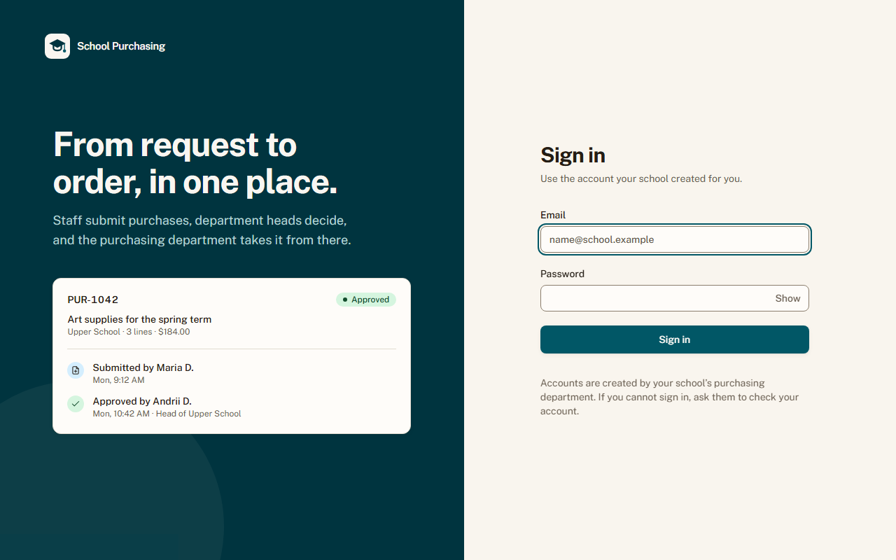

**Кроки:** ✔ Дано: гість без входу → ✔ Коли: гість відкриває пряме посилання на форму закупівлі → ✔ Тоді: він бачить сторінку входу, а форму закупівлі не показано

**Агент (claude-haiku-5-5, PASS):** На кадрі frame-then-1.png (сторінка /login) видно заголовок «Sign in», поле «Email» з плейсхолдером «name@school.example» і поле «Password» з кнопкою «Show». Кадр повний і читабельний, завантаження немає. Відсутність форми закупівлі оцінено як «не з кадрів» за правилами.

**Цитати агента, звірені зі сторінкою (aria):**
- «Sign in» — є на сторінці
- «Email» — є на сторінці
- «Password» — є на сторінці

**Правило:** R6: перевірки, агент і цитати збігаються

**Відео:** `test-results/artifacts/slice2-гість-без-входу-AC--2c359-форму-закупівлі-не-показано-chromium/video.webm` · **траса:** `test-results/artifacts/slice2-гість-без-входу-AC--2c359-форму-закупівлі-не-показано-chromium/trace.zip` (не в git)

**Рішення PM:** ☐ приймаю · ☐ відхилення від вимог (issue «Відхилення від вимог: AC-FRM-09 — …») · @login: ____

## AC-FRM-14 — PASS

**Тест:** AC-FRM-14: працівник без жодної заявки відкриває «Мої заявки» і бачить повідомлення про порожній список, а списку заявок немає

**Критерій** (requirements/47-pratsivnyk-podaie-zakupivliu-formu.md):

> AC-FRM-14: Дано працівник 3 без жодної заявки. Коли він відкриває сторінку «Мої заявки». Тоді він бачить повідомлення «Ви ще не подали жодної заявки», а списку заявок немає.

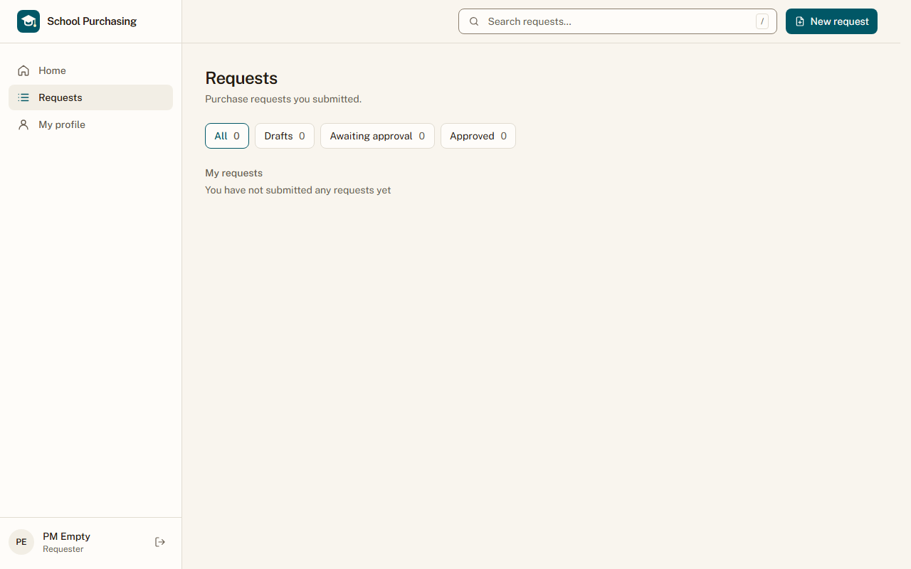

**Кроки:** ✔ Дано: працівник pm-empty@example.test без жодної заявки (чернеток теж) увійшов у застосунок → ✔ Коли: відкриває сторінку «Мої заявки» → ✔ Тоді: він бачить повідомлення «Ви ще не подали жодної заявки» (в інтерфейсі англійською: «You have not submitted any requests yet», requirements/49), а списку заявок немає

**Агент (claude-sonnet-5-5, PASS):** На кадрі сторінка Requests із розділом «My requests» і повідомленням «You have not submitted any requests yet». Лічильники вкладок показують 0, а списку заявок не видно.

Haiku сказав FAIL, тож розбір повторив Sonnet; рішення агента — за Sonnet.

**Цитати агента, звірені зі сторінкою (aria):**
- «My requests» — є на сторінці
- «You have not submitted any requests yet» — є на сторінці

**Правило:** R6: перевірки, агент і цитати збігаються

**Відео:** `test-results/artifacts/slice2-працівник-без-жодно-38de7-писок-а-списку-заявок-немає-chromium/video.webm` · **траса:** `test-results/artifacts/slice2-працівник-без-жодно-38de7-писок-а-списку-заявок-немає-chromium/trace.zip` (не в git)

**Рішення PM:** ☐ приймаю · ☐ відхилення від вимог (issue «Відхилення від вимог: AC-FRM-14 — …») · @login: ____

## AC-HIST-01 — PASS

**Тест:** AC-HIST-01: працівник 1 подає першу закупівлю, а потім другу — в списку «Мої заявки» вони мають номери «PUR-n» і «PUR-(n+1)» поспіль (на проді нумерація спільна: за погодженням з PM, issues #73 і #76, UAT перевіряє два номери поспіль, а абсолютні «PUR-1» і «PUR-2» доведено тестом на порожній базі, tests/db/dec-hist.test.ts)

**Критерій** (requirements/64-zaiavka-maie-nomer-sumy-istoriiu.md):

> AC-HIST-01: Дано в системі ще немає жодної закупівлі. Коли працівник 1 подає першу закупівлю, а потім другу. Тоді в списку «Мої заявки» вони мають номери «PUR-1» і «PUR-2».

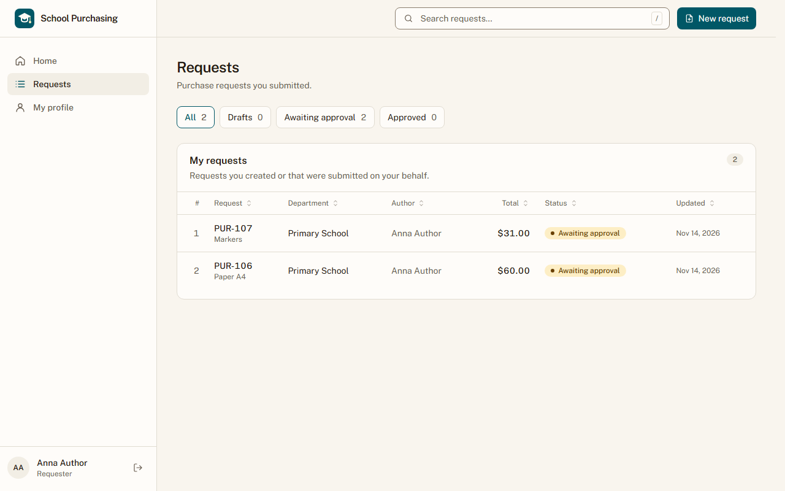

**Кроки:** ✔ Дано: працівник 1 у відділі «Primary School»; база НЕ порожня (нумерація на проді спільна), тож перевіряємо дві закупівлі поспіль, як погоджено з PM → ✔ Коли: працівник 1 подає першу закупівлю, а потім другу → ✔ Тоді: в списку «Мої заявки» вони мають номери «PUR-n» і «PUR-(n+1)» поспіль (погоджено з PM, issues #73 і #76: на проді нумерація спільна, тож абсолютні «PUR-1» і «PUR-2» UAT не перевіряє; їх доводить тест бази на порожній базі)

**Агент (claude-haiku-5-5, PASS):** На кадрі сторінка «Requests» з розділом «My requests» і лічильником 2. У таблиці два рядки поспіль: PUR-107 (рядок 1) і PUR-106 (рядок 2), обидва в статусі «Awaiting approval». Видима частина «Тоді» виконана; порядок рядків на кадрі зворотний до порядку номерів у критерії, але сама умова про «поспіль» цього не вимагає. Твердження про PUR-1 і PUR-2 не оцінювалося: воно з розділу «Не з кадрів».

**Цитати агента, звірені зі сторінкою (aria):**
- «My requests» — є на сторінці
- «PUR-107» — є на сторінці
- «PUR-106» — є на сторінці

**Правило:** R6: перевірки, агент і цитати збігаються

**Відео:** `test-results/artifacts/slice3-номер-суми-й-історі-6ed0a--tests-db-dec-hist-test-ts--chromium/video.webm` · **траса:** `test-results/artifacts/slice3-номер-суми-й-історі-6ed0a--tests-db-dec-hist-test-ts--chromium/trace.zip` (не в git)

**Рішення PM:** ☐ приймаю · ☐ відхилення від вимог (issue «Відхилення від вимог: AC-HIST-01 — …») · @login: ____

## AC-HIST-02 — PASS

**Тест:** AC-HIST-02: автор відкриває закупівлю з двома рядками (кількість 3 за ціною 20.00 і кількість 2 за ціною 15.50) — суми рядків 60.00 і 31.00, а сума заявки 91.00

**Критерій** (requirements/64-zaiavka-maie-nomer-sumy-istoriiu.md):

> AC-HIST-02: Дано закупівля з двома рядками: кількість 3 за ціною 20.00 і кількість 2 за ціною 15.50. Коли автор відкриває заявку. Тоді суми рядків 60.00 і 31.00, а сума заявки 91.00.

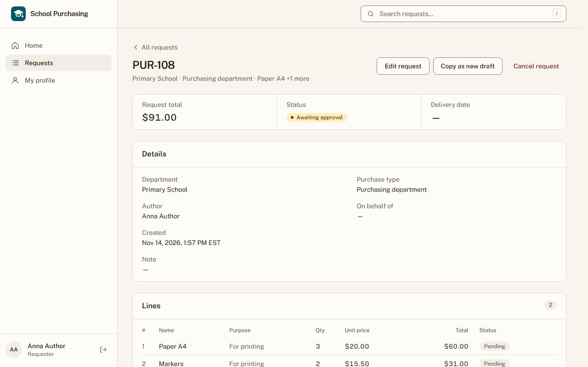

**Кроки:** ✔ Дано: закупівля з двома рядками: кількість 3 за ціною 20.00 і кількість 2 за ціною 15.50 → ✔ Коли: автор відкриває заявку → ✔ Тоді: суми рядків 60.00 і 31.00, а сума заявки 91.00

**Агент (claude-haiku-5-5, PASS):** На кадрі сторінка PUR-108: у таблиці Lines рядок 1 (Paper A4, 3 × $20.00) має Total $60.00, рядок 2 (Markers, 2 × $15.50) — Total $31.00, який видно біля нижнього краю кадру, але читабельно. Під підписом «Request total» показано $91.00.

**Цитати агента, звірені зі сторінкою (aria):**
- «$60.00» — є на сторінці
- «$31.00» — є на сторінці
- «Request total» — є на сторінці
- «$91.00» — є на сторінці

**Правило:** R6: перевірки, агент і цитати збігаються

**Відео:** `test-results/artifacts/slice3-номер-суми-й-історі-3d864-і-31-00-а-сума-заявки-91-00-chromium/video.webm` · **траса:** `test-results/artifacts/slice3-номер-суми-й-історі-3d864-і-31-00-а-сума-заявки-91-00-chromium/trace.zip` (не в git)

**Рішення PM:** ☐ приймаю · ☐ відхилення від вимог (issue «Відхилення від вимог: AC-HIST-02 — …») · @login: ____

## AC-HIST-06 — PASS

**Тест:** AC-HIST-06: працівник 1 подав закупівлю у відділ «Початкова школа» і відкриває її історію — в історії є запис «Подано» з його іменем і датою та часом за часом America/New_York

**Критерій** (requirements/64-zaiavka-maie-nomer-sumy-istoriiu.md):

> AC-HIST-06: Дано працівник 1 подав закупівлю у відділ «Початкова школа». Коли він відкриває історію цієї заявки. Тоді в історії є запис «Подано» з його іменем і датою та часом за часом `America/New_York`.

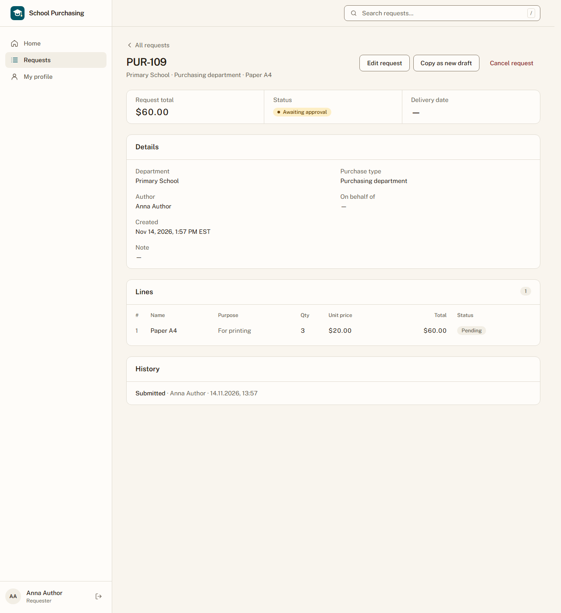

**Кроки:** ✔ Дано: працівник 1 подав закупівлю у відділ «Primary School» → ✔ Коли: він відкриває історію цієї заявки → ✔ Тоді: в історії є запис «Подано» з його іменем і датою та часом за часом America/New_York

**Агент (claude-sonnet-5-5, PASS):** У картці History видно один запис «Submitted · Anna Author · 14.11.2026, 13:57». Формат ДД.ММ.РРРР, ГГ:ХХ у 24-годинному вигляді, без позначки поясу. Це збігається з очікуваним, а у блоці Details «Created» показано 1:57 PM EST, тобто час теж відповідає.

Haiku сказав NEEDS-HUMAN, тож розбір повторив Sonnet; рішення агента — за Sonnet.

**Цитати агента, звірені зі сторінкою (aria):**
- «History» — є на сторінці
- «Submitted · Anna Author · 14.11.2026, 13:57» — є на сторінці

**Правило:** R6: перевірки, агент і цитати збігаються

**Відео:** `test-results/artifacts/slice3-номер-суми-й-історі-ce3de-м-за-часом-America-New-York-chromium/video.webm` · **траса:** `test-results/artifacts/slice3-номер-суми-й-історі-ce3de-м-за-часом-America-New-York-chromium/trace.zip` (не в git)

**Рішення PM:** ☐ приймаю · ☐ відхилення від вимог (issue «Відхилення від вимог: AC-HIST-06 — …») · @login: ____

## AC-HIST-10 — PASS

**Тест:** AC-HIST-10: Петро схвалює лише відділ «Офіс» і відкриває за прямим посиланням історію заявки відділу «Початкова школа» з історією рішень — він бачить повідомлення «Недостатньо прав», історії не показано, а статус заявки не змінився

**Критерій** (requirements/64-zaiavka-maie-nomer-sumy-istoriiu.md):

> AC-HIST-10: Дано Петро схвалює лише відділ «Офіс», заявка відділу «Початкова школа» з історією рішень. Коли Петро відкриває історію цієї заявки за прямим посиланням. Тоді він бачить повідомлення «Недостатньо прав», історії не показано, а статус заявки не змінився.

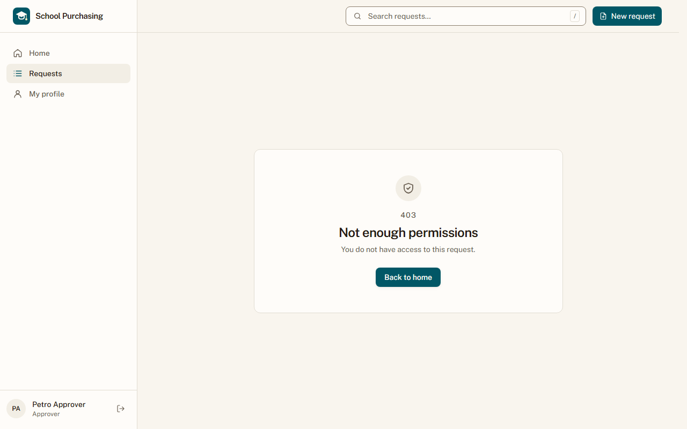

**Кроки:** ✔ Дано: Петро схвалює лише відділ «Office»; заявка відділу «Primary School» з історією рішень (Марія повернула її з причиною) → ✔ Коли: Петро відкриває історію цієї заявки за прямим посиланням → ✔ Тоді: він бачить повідомлення «Недостатньо прав», історії не показано, а статус заявки не змінився

**Агент (claude-sonnet-5-5, PASS):** На кадрі сторінка 403 із заголовком «Not enough permissions» і текстом «You do not have access to this request.». Карток «History» чи даних заявки немає, лише кнопка «Back to home». Статус у базі за кадром не оцінювався.

Haiku сказав FAIL, тож розбір повторив Sonnet; рішення агента — за Sonnet.

**Цитати агента, звірені зі сторінкою (aria):**
- «Not enough permissions» — є на сторінці
- «You do not have access to this request.» — є на сторінці

**Правило:** R6: перевірки, агент і цитати збігаються

**Відео:** `test-results/artifacts/slice3-номер-суми-й-історі-f5109-а-статус-заявки-не-змінився-chromium/video.webm` · **траса:** `test-results/artifacts/slice3-номер-суми-й-історі-f5109-а-статус-заявки-не-змінився-chromium/trace.zip` (не в git)

**Рішення PM:** ☐ приймаю · ☐ відхилення від вимог (issue «Відхилення від вимог: AC-HIST-10 — …») · @login: ____

## AC-LANG-09 — PASS

**Тест:** AC-LANG-09: заявки зі статусами «Частково схвалено» і «Повернено на доопрацювання» показано у списку й на сторінці заявки — статус підписано текстом «Partially approved» чи «Returned for revision», а не лише кольором

**Критерій** (requirements/49-interfejs-anhlijskoiu-movoiu.md):

> AC-LANG-09: Дано заявка зі статусом «Частково схвалено» чи «Повернено на доопрацювання». Коли її показано у списку, на сторінці заявки або в історії. Тоді статус підписано текстом «Partially approved» чи «Returned for revision» відповідно, а не лише кольором.

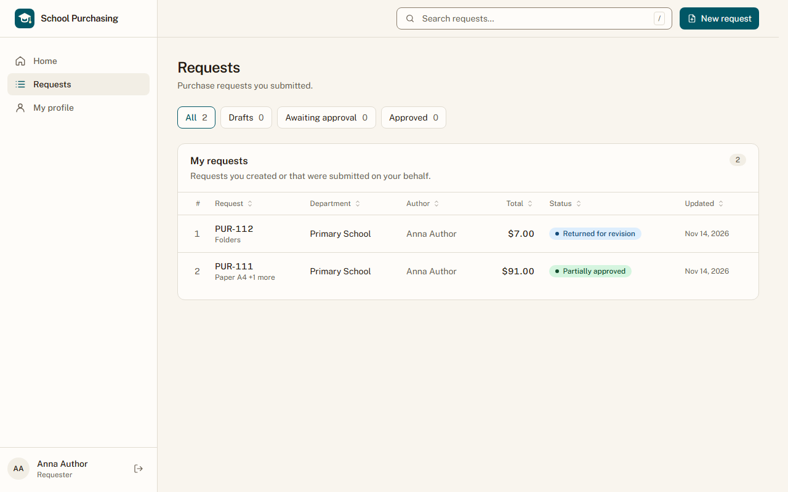

**Кроки:** ✔ Дано: заявки зі статусами «Partially approved» і «Returned for revision» → ✔ Коли: автор відкриває список «Мої заявки» і сторінки цих заявок → ✔ Тоді: статус підписано текстом «Partially approved» чи «Returned for revision» відповідно, а не лише кольором

**Агент (claude-sonnet-5-5, PASS):** На кадрі в списку «My requests» рядок PUR-112 має бейдж «Returned for revision», а PUR-111 — «Partially approved». Статуси підписано текстом, а не лише кольором. Сторінки заявок не оцінювались.

Haiku сказав PASS, тож розбір повторив Sonnet; рішення агента — за Sonnet.

**Цитати агента, звірені зі сторінкою (aria):**
- «My requests» — є на сторінці
- «PUR-112» — є на сторінці
- «Returned for revision» — є на сторінці
- «PUR-111» — є на сторінці
- «Partially approved» — є на сторінці

**Правило:** R6: перевірки, агент і цитати збігаються

**Відео:** `test-results/artifacts/slice3-підписи-статусів-AC-1463e-evision»-а-не-лише-кольором-chromium/video.webm` · **траса:** `test-results/artifacts/slice3-підписи-статусів-AC-1463e-evision»-а-не-лише-кольором-chromium/trace.zip` (не в git)

**Рішення PM:** ☐ приймаю · ☐ відхилення від вимог (issue «Відхилення від вимог: AC-LANG-09 — …») · @login: ____

## Як читати підсумок

- **PASS** — автоматичні перевірки пройшли, агент-рецензент погодився з кадром, а кожну його цитату знайдено на сторінці.
- **FAIL** — впала автоматична перевірка. Агент цього не перекриває: невидимі вади (буфер обміну, база) він на кадрі не побачить.
- **NEEDS-HUMAN** — перевірки зелені, але агент не погодився або його цитати немає на сторінці. Часто це слабкий тест або розбіжність між текстом AC і тестом — питання до PM, а не обов'язково вада продукту.

Правила: R1: перевірка впала — FAIL завжди, агент не перекриває; R2: немає вердикту агента або кадру; R3: перевірки пройшли, агент не погоджується — вирішує людина; R4: цитати агента немає на сторінці (aria) — не підтверджено; R5: помилка сторінки або 5xx під час сценарію; R6: перевірки, агент і цитати збігаються.
