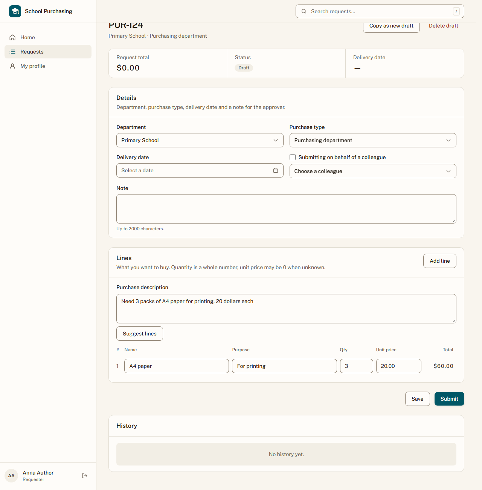

# Звіт UAT — 16.11.2026

- **Застосунок:** https://school-purchasing.vercel.app (/api/health: коміт `1b0d6f2`)
- **Код тестів:** `task/slice4-finish` @ `1b0d6f2`
- **Прогін:** 16.11.2026, 20:11 (Київ), Playwright 39.7 с; AC: 1 — PASS 1, FAIL 0, NEEDS-HUMAN 0
- **Рецензент:** `claude-haiku-5-5`; суперечки → `claude-sonnet-5-5`. Разом за розбір: $0.0025 (ціни API; за підпискою — у межах ліміту плану)
- **Прибирання:** синтетичних uat-*@example.test видалено 1, лишилось 0, їхніх рядків, що лишились: 0
- **Відео й траси:** не в git — `test-results/` локально або артефакт CI; трасу відкриває `npx playwright show-trace <trace.zip>`

| AC | Перевірки | Агент | Підсумок | Чому | Playwright | Розбір |
|---|---|---|---|---|---|---|
| AC-AI-01 | пройшли | Haiku: PASS | **PASS** | R6: перевірки, агент і цитати збігаються | 19.8 с | $0.0025, 7.8 с |

## AC-AI-01 — PASS

**Тест:** AC-AI-01: працівник вставляє опис про A4 paper — бачить один рядок «A4 paper», «For printing», 3, 20.00, закупівлю ще не подано

**Критерій** (requirements/71-ai-proponuie-riadky-zakupivli.md):

> AC-AI-01: Дано працівник 1 відкрив форму нової закупівлі. Коли він вставляє опис «Need 3 packs of A4 paper for printing, 20 dollars each» і натискає «Suggest lines». Тоді він бачить один рядок: назва «A4 paper», мета «For printing», кількість 3, ціна 20.00, а закупівлю ще не подано.

**Кроки:** ✔ Дано: працівник 1 відкрив форму нової закупівлі → ✔ Коли: він вставляє опис «Need 3 packs of A4 paper for printing, 20 dollars each» і натискає «Suggest lines» → ✔ Тоді: він бачить один рядок: назва «A4 paper», мета «For printing», кількість 3, ціна 20.00, а закупівлю ще не подано

**Агент (claude-haiku-5-5, PASS):** На кадрі в таблиці «Lines» видно один рядок (№ 1) з назвою «A4 paper», метою «For printing», Qty 3 і Unit price 20.00, а статус заявки — «Draft». Опис «Need 3 packs of A4 paper for printing, 20 dollars each» також видно в полі Purchase description. Заголовок сторінки «PUR-124» обрізаний зверху, але це не впливає на перевірку.

**Цитати агента, звірені зі сторінкою (aria):**
- «A4 paper» — є на сторінці
- «For printing» — є на сторінці
- «3» — є на сторінці
- «20.00» — є на сторінці
- «Draft» — є на сторінці

**Правило:** R6: перевірки, агент і цитати збігаються

**Відео:** `test-results/artifacts/slice4-AI-помічник-пропози-6b199-0-00-закупівлю-ще-не-подано-chromium/video.webm` · **траса:** `test-results/artifacts/slice4-AI-помічник-пропози-6b199-0-00-закупівлю-ще-не-подано-chromium/trace.zip` (не в git)

**Рішення PM:** ☐ приймаю · ☐ відхилення від вимог (issue «Відхилення від вимог: AC-AI-01 — …») · @login: ____

## Як читати підсумок

- **PASS** — автоматичні перевірки пройшли, агент-рецензент погодився з кадром, а кожну його цитату знайдено на сторінці.
- **FAIL** — впала автоматична перевірка. Агент цього не перекриває: невидимі вади (буфер обміну, база) він на кадрі не побачить.
- **NEEDS-HUMAN** — перевірки зелені, але агент не погодився або його цитати немає на сторінці. Часто це слабкий тест або розбіжність між текстом AC і тестом — питання до PM, а не обов'язково вада продукту.

Правила: R1: перевірка впала — FAIL завжди, агент не перекриває; R2: немає вердикту агента або кадру; R3: перевірки пройшли, агент не погоджується — вирішує людина; R4: цитати агента немає на сторінці (aria) — не підтверджено; R5: помилка сторінки або 5xx під час сценарію; R6: перевірки, агент і цитати збігаються.
